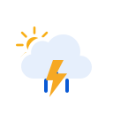
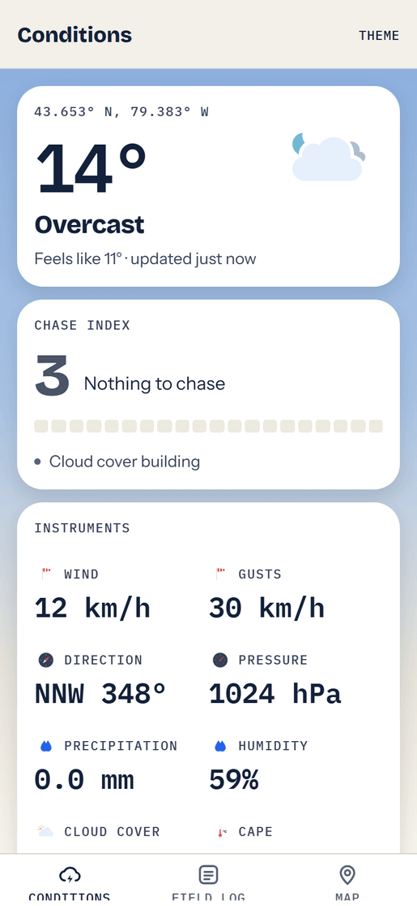
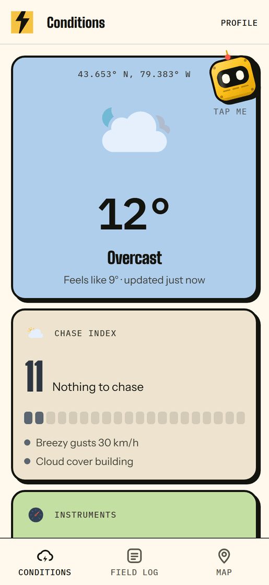
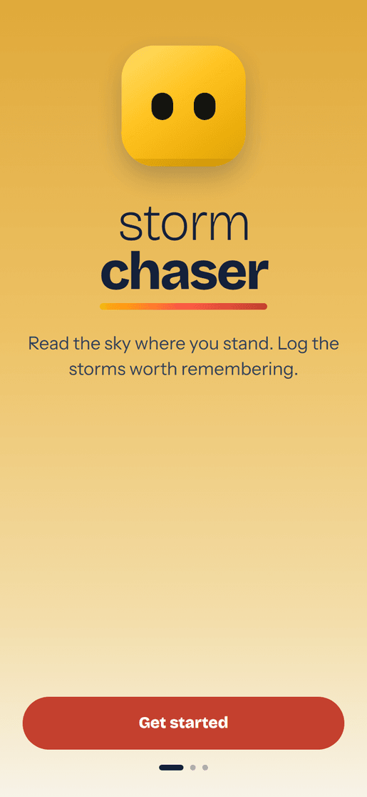
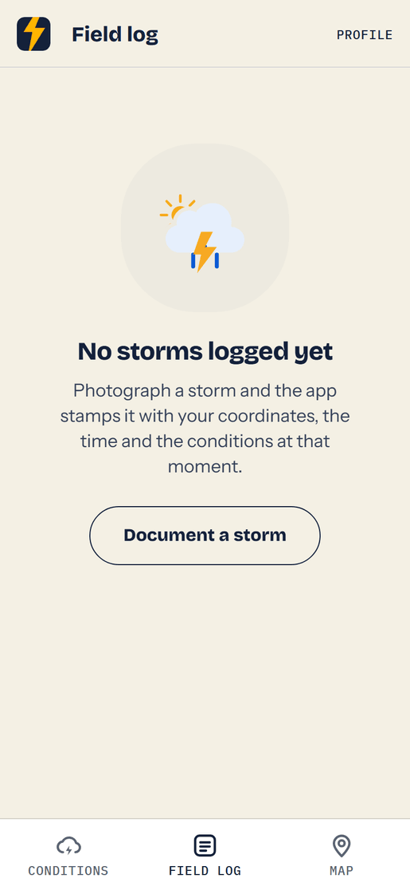
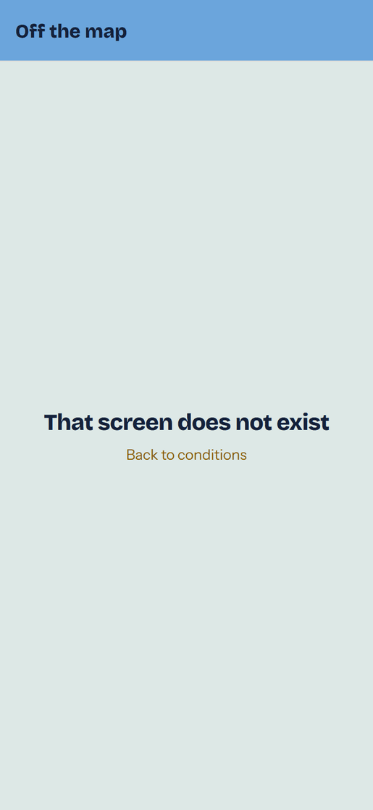
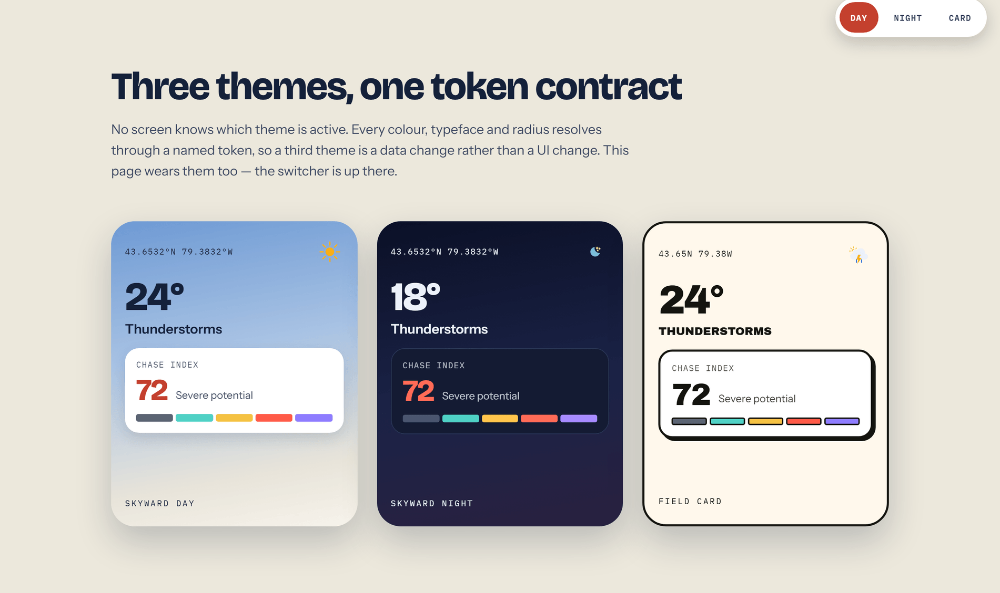
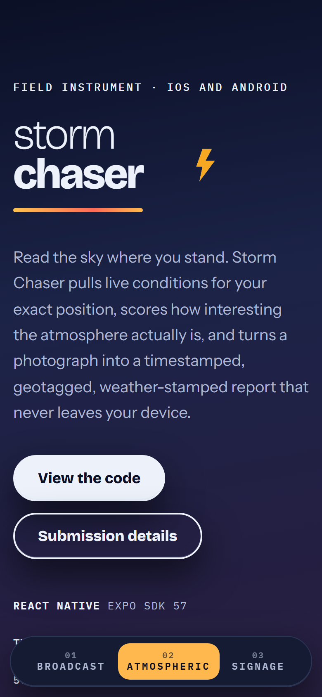
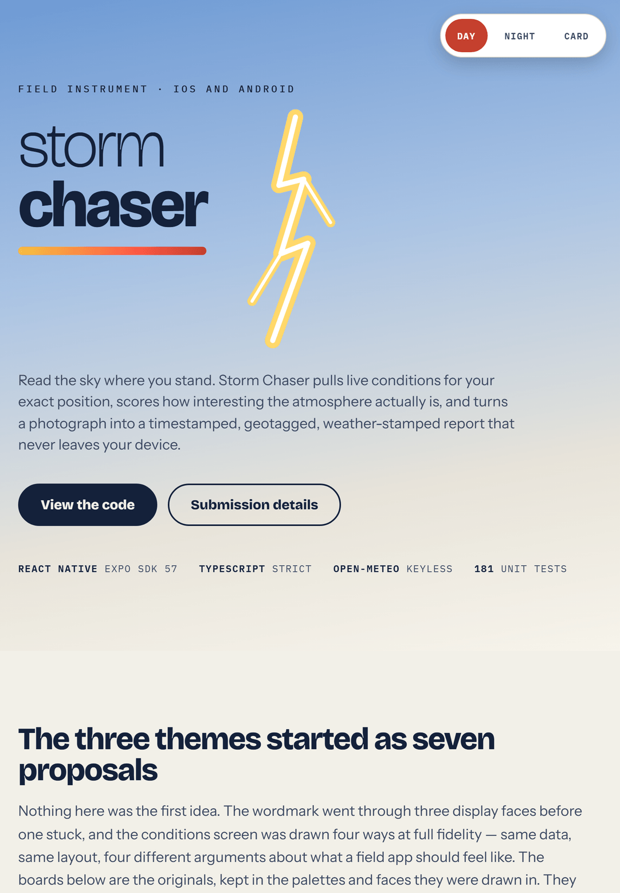
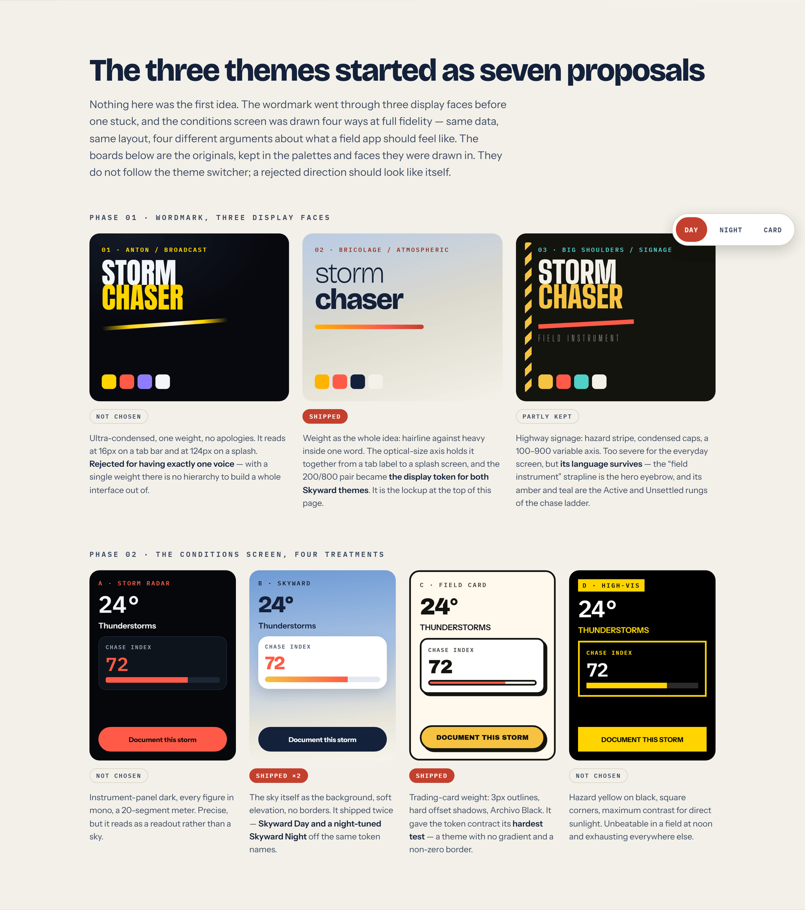

<div align="center">

  

  <h1>Storm Chaser</h1>

  <p>
    A field app for storm chasing hobbyists. It reads the sky where you are standing,
    scores how interesting the atmosphere actually is, and turns a photograph into a
    timestamped, geotagged, weather stamped report that never leaves your device.
  </p>

<p>
  
  
  
  
  
  
</p>

<h4>
    <a href="https://drive.google.com/file/d/1hHfLGWvkn_EwCxRvGiozFD_H-ZrF_eAD/view?usp=sharing">Watch the Walkthrough</a>
  <span> · </span>
    <a href="https://stormchaser-field.vercel.app">View Showcase</a>
  <span> · </span>
    <a href="docs/ARCHITECTURE.md">Documentation</a>
  <span> · </span>
    <a href="https://github.com/melaniesigrid/storm-chaser/issues">Report Bug</a>
  <span> · </span>
    <a href="https://github.com/melaniesigrid/storm-chaser/issues">Request Feature</a>
  </h4>

  <sub>Built for the Speer Technologies mobile assessment.</sub>

</div>

<br />

<!-- Table of Contents -->
# :notebook_with_decorative_cover: Table of Contents

- [About the Project](#star2-about-the-project)
  * [Walkthrough](#clapper-walkthrough)
  * [Screenshots](#camera-screenshots)
  * [Tech Stack](#space_invader-tech-stack)
  * [Features](#dart-features)
  * [Branding](#art-branding)
  * [Environment Variables](#key-environment-variables)
- [Getting Started](#toolbox-getting-started)
  * [Prerequisites](#bangbang-prerequisites)
  * [Installation](#gear-installation)
  * [Running Tests](#test_tube-running-tests)
  * [Run Locally](#running-run-locally)
  * [Deployment](#triangular_flag_on_post-deployment)
- [Usage](#eyes-usage)
- [Project Structure](#open_file_folder-project-structure)
- [Architecture](#building_construction-architecture)
- [Brief Coverage](#clipboard-brief-coverage)
- [Roadmap](#compass-roadmap)
- [Contributing](#wave-contributing)
- [License](#warning-license)
- [Contact](#handshake-contact)
- [Acknowledgements](#gem-acknowledgements)

<!-- About the Project -->
## :star2: About the Project

Generic weather apps answer "do I need a coat". A chaser needs a different question
answered: **can this atmosphere build something, and is it worth driving toward.**

Storm Chaser pulls live conditions for the exact position you are standing in, surfaces
the two variables generic apps leave out, CAPE and lifted index, and folds them into a
**Chase Index**, a 0 to 100 score with a ranked list of what drove it. When something
does happen, the camera flow stamps the photograph with the time, the coordinates, the
position accuracy and the complete weather snapshot, then writes it to a local field log
that works with no signal and no account.

It is a judgement aid, not a forecast product, and it says so in the UI.

<!-- Walkthrough -->
### :clapper: Walkthrough

<div align="center">
  
</div>

**[Watch it with sound and at full size on Google Drive](https://drive.google.com/file/d/1hHfLGWvkn_EwCxRvGiozFD_H-ZrF_eAD/view?usp=sharing)**

Recorded on a device, which is the only place the map tab is real: `react-native-maps`
is native only, so the web export the stills below come from draws a stand-in in its
place. The run covers first launch and the location primer, live conditions and the
Chase Index, the camera capture flow through to a saved report, the field log and the
map, and the themes.

<!-- Screenshots -->
### :camera: Screenshots

<!--
Regenerate everything below with:
  npm run screenshots        the app itself, from source (scripts/capture-app-screenshots.mjs)
  npm run screenshots:site   the showcase site (scripts/capture-screenshots.mjs)
Prerequisite: npx playwright install chromium
App captures at 390x844, device scale factor 2. Storm Chaser is a phone app.
CAPTURE_LAT / CAPTURE_LON move the capture position; the weather is live.
-->

These are the real app, not mockups. `npm run screenshots` re-exports `app/` and `src/`
with `expo export --platform web` on every run and drives the result in a browser, so the
images below cannot drift from the code. Change a screen, run the script, the README
updates. The weather is live too: the Chase Index you see is whatever the atmosphere over
the capture position was doing at the time.

**Conditions:** 43.653° N, 79.383° W, on two of the four themes

Storm Chaser ships as a phone app, so every capture is a phone: 390 × 844 at 2x. The two
below are the same screen a second apart. Skyward Day runs a four-stop sky, blue at the
zenith, through a haze band, into low warm light at the horizon, and floats frosted panes
in front of it, with the header and the tab bar taking the first and last stop so the
chrome is part of the sky rather than a bar laid over it. Field Card is printed stock, and
gives every card its own colour off a twelve-stock palette so a column reads as a handful
of collected cards rather than one long white sheet.

| Skyward Day | Field Card |
| :---: | :---: |
|  |  |

<details>
  <summary><b>More screens</b>: onboarding, the field log empty state, the theme picker</summary>
  <br />

| Onboarding | Field log | Appearance |
| :---: | :---: | :---: |
|  |  |  |

</details>

> **Two honest gaps.** The **Map** tab is missing from this set because
> `react-native-maps` is native only. It calls `codegenNativeComponent`, which has no web
> implementation, so it has to be captured from a device. The **capture flow** is missing
> for the same class of reason: photographing a storm needs a camera and a real photo, and
> a fake webcam feed would put a test pattern in the field log rather than a storm.
>
> The tab bar labels clip slightly in the phone capture. That is not a rendering artefact
> of this pipeline: the bar has no bottom safe-area inset on web, which is also true of an
> Android device on three-button navigation, so it is worth a look.

#### The design system, and the showcase site

<div align="center">
  
</div>

<details>
  <summary><b>Showcase site</b>: <a href="https://stormchaser-field.vercel.app">stormchaser-field.vercel.app</a>, at three widths</summary>
  <br />

<div align="center">
  
</div>

| Mobile (390 × 844) | Tablet (820 × 1180) |
| :---: | :---: |
|  |  |

</details>

<!-- TechStack -->
### :space_invader: Tech Stack

<details>
  <summary>App</summary>
  <ul>
    <li><a href="https://reactnative.dev/">React Native</a> 0.86, new architecture enabled</li>
    <li><a href="https://expo.dev/">Expo</a> SDK 57</li>
    <li><a href="https://www.typescriptlang.org/">TypeScript</a>, strict</li>
    <li><a href="https://docs.expo.dev/router/introduction/">Expo Router</a> with typed routes</li>
    <li><a href="https://docs.swmansion.com/react-native-reanimated/">Reanimated</a> 4, Reduce Motion aware</li>
    <li><a href="https://github.com/software-mansion/react-native-svg">react-native-svg</a> for icon rendering</li>
    <li><a href="https://github.com/react-native-maps/react-native-maps">react-native-maps</a></li>
    <li><a href="https://airbnb.io/lottie/">Lottie</a> for the hero condition animation</li>
  </ul>
</details>

<details>
  <summary>Data &amp; state</summary>
  <ul>
    <li><a href="https://tanstack.com/query/latest">TanStack Query</a> v5, the only async entry point for UI</li>
    <li><a href="https://tanstack.com/query/latest/docs/framework/react/plugins/persistQueryClient">persistQueryClient</a> over <a href="https://react-native-async-storage.github.io/async-storage/">AsyncStorage</a>, 24 hour cache</li>
    <li><a href="https://open-meteo.com/">Open-Meteo</a> for current, hourly and daily forecast, no key required</li>
    <li>App document directory (<a href="https://docs.expo.dev/versions/latest/sdk/filesystem/">expo-file-system</a>) for photos</li>
  </ul>
</details>

<details>
  <summary>Device</summary>
  <ul>
    <li><a href="https://docs.expo.dev/versions/latest/sdk/camera/">expo-camera</a>, <a href="https://docs.expo.dev/versions/latest/sdk/imagepicker/">expo-image-picker</a>, <a href="https://docs.expo.dev/versions/latest/sdk/location/">expo-location</a>, <a href="https://docs.expo.dev/versions/latest/sdk/haptics/">expo-haptics</a></li>
    <li><a href="https://docs.expo.dev/versions/latest/sdk/network/">expo-network</a> for the connectivity probe</li>
    <li><a href="https://docs.expo.dev/versions/latest/sdk/font/">expo-font</a> + <a href="https://github.com/expo/google-fonts">@expo-google-fonts</a></li>
  </ul>
</details>

<details>
  <summary>Tooling</summary>
  <ul>
    <li><a href="https://jestjs.io/">Jest</a> via <a href="https://www.npmjs.com/package/jest-expo">jest-expo</a>, 734 tests, mostly pure functions, no mocking framework</li>
    <li><a href="https://github.com/kristerkari/react-native-svg-transformer">react-native-svg-transformer</a> so Meteocons import as components</li>
    <li><a href="https://playwright.dev/">Playwright</a> + <a href="https://necolas.github.io/react-native-web/">react-native-web</a>, which is how the screenshot pipeline renders the real app in a browser</li>
    <li><a href="https://vercel.com/">Vercel</a> for the static showcase site in <code>landing/</code></li>
  </ul>
</details>

<!-- Features -->
### :dart: Features

**Conditions.** A position fix, then current conditions, a 12 hour hourly series and a
7 day outlook from Open-Meteo. Temperature, apparent temperature, wind, gusts, bearing,
pressure, humidity, cloud and precipitation, plus CAPE and lifted index.

**Chase Index.** A 0 to 100 heuristic combining the observed weather code, gust strength,
rainfall rate and the convective indices, with a ranked list of the factors driving the
score. The maths is one pure, tested module:
[`features/weather/model/severity.ts`](src/features/weather/model/severity.ts).

**Field log.** Camera capture, then a metadata form. Selecting a classification shows a
sentence on how to recognise it from the ground, because twelve labels are not
self-explanatory to someone learning the sky and a wall cloud filed as a shelf cloud is a
wrong record rather than an untidy one. A photo already in the library can
be imported instead: storms do not wait for the person holding the phone, and a shot taken
on a real camera and copied across documents the same event. Imported reports are recorded
as such and say so on the form and on the record, because their position and conditions are
the device's at import time, not the storm's. Classification and notes are typed
by the user; time, coordinates, accuracy and the full weather snapshot are captured
automatically and shown read only so they can be verified before saving. Photo first,
record second: if the image cannot be copied into permanent storage, the report is never
written, so the log can never point at a file that is not there.

**Map.** Every report with a position fix, plotted and coloured by severity tier, with
the viewport fitted to the set. Tapping a callout opens the report.

**Community.** Storms other chasers logged, drawn around you as hollow rings so someone
else's report can never be mistaken for one of your own at a glance. With no sync backend
configured they come from a bundled sample set of 39, badged **community · demo data** in
the legend. Six are generated relative to your position, so the map is populated wherever
you are standing; the other 33 sit at fixed coordinates in storm-prone places on every
inhabited continent, so the map is worth zooming out of. They are a separate type from your reports
and never enter the repository.

**Storm legends.** 22 famous storm places (Catatumbo lightning, Hector the Convector,
the Tri-State Tornado) plotted as a third pin shape on the map wherever in the world you are, each with a
detail route at `/legend/[id]` carrying its claim, its fact, its season and the great
circle distance from you. Each one carries a photograph, two paragraphs on the mechanism
and the consequence, and a block of checkable figures. A legend of the day surfaces on
Conditions as a lore card, so the map has something worth opening before you have logged
anything.

The photographs come from Wikimedia Commons, with the licence read from the Commons API
rather than assumed: only public domain, CC0, CC BY and CC BY-SA files were kept, and each
is credited in the app and in [docs/IMAGE_CREDITS.md](docs/IMAGE_CREDITS.md). Where no
freely licensed photograph of a specific historical storm exists, which for a tornado in
1925 is usually the case, the image illustrates the phenomenon instead, and the caption
printed underneath says what it actually shows. A legend with no acceptable image keeps
its icon. They are a separate
type from reports and from community pins: no photo, no weather snapshot, no owner, and
they never touch `StormRepository`. The table and its distance maths are one pure module,
[`features/storms/model/legends.ts`](src/features/storms/model/legends.ts).

**Charts.** `Sparkline` and `RangeBar` over one set of shared scaling geometry in
[`src/core/charts`](src/core/charts), wired into the 12 hour strip and the 7 day outlook so
the next half day and the week read as shapes rather than columns of figures. The geometry
is pure and tested: a non-finite reading is dropped rather than scaled into a spike, and
every plotted point stays aligned with the hour it describes.

**Offline.** A persisted query cache, an explicit offline banner over the last good
reading with its age, and a bundled sample dataset you opt into from the Not found view,
labelled as sample data everywhere it appears. The field log itself needs no network at all.

**Three themes.** Switchable in onboarding and in Settings. No screen knows which one is
active. An explicit choice overrides system appearance permanently: a field app that flips
to light at sunrise while someone is out chasing is wrong.

**Accessibility is asserted in the test suite.**
[`theme.test.ts`](__tests__/theme.test.ts) asserts WCAG AA for body text, muted text, both
tab states and the primary action across all three themes, and carries regression guards
for two defects that shipped in v1.0: an offline banner at **1.22:1** in light mode and a
muted token at **2.0:1** in dark mode. Nothing renders below 12px; every tappable control
clears 44px.

**Motion that knows when to stop.** Saving a report fires a confetti burst and a success
haptic over the field log, where the new report just landed. Volt, the mascot, is pure
geometry with no image assets. Every motion respects Reduce Motion: with it on, the
confetti and the meter animation are skipped entirely and the information is identical.

<!-- Branding -->
### :art: Branding

Everything visual resolves through a named token in
[`src/core/theme/themes.ts`](src/core/theme/themes.ts). A screen never asks which theme is
active; it asks the active theme for a token. Adding a fourth theme is a data change.

#### Design process

The theme system below is the *result*. It is worth recording what it beat, because the
token contract exists precisely because these directions disagreed with each other so
hard that no screen could be allowed to hard-code a colour.

Two rounds were drawn at full fidelity on a design canvas before any of it reached
`themes.ts`: three wordmarks, then the conditions screen four ways with identical data
and identical layout, so the only variable was the treatment.

<div align="center">
  
</div>

<br />

**Round one: the wordmark.** Three display faces, each with its own app-icon lockup,
palette and motion.

| Direction | Face | Argument | Outcome |
| --- | --- | --- | --- |
| 01 · Broadcast | **Anton** | Ultra-condensed, one weight, no apologies. Reads at 16px on a tab bar and at 124px on a splash. | **Rejected.** One weight means no hierarchy, and there is nothing to build a whole interface out of. |
| 02 · Atmospheric | **Bricolage Grotesque** | Weight as the whole idea: hairline against heavy inside one word, with the optical-size axis holding it together as it shrinks. | **Shipped.** The 200/800 pair became the display token for both Skyward themes and the wordmark on the showcase site. |
| 03 · Signage | **Big Shoulders Display** | Highway signage: hazard stripe, condensed caps, a 100 to 900 variable axis, a "FIELD INSTRUMENT" strapline. | **Partly kept.** Too severe as the everyday voice, but its strapline is the showcase site's hero eyebrow and its amber `#F5C242` and teal `#4FD1C5` are the Active and Unsettled rungs of the chase ladder. |

**Round two: the conditions screen.** The same screen, the same numbers, four treatments.

| Direction | Ground | Display face | Outcome |
| --- | --- | --- | --- |
| A · Storm Radar | `#05070B` instrument dark | IBM Plex Mono throughout | **Rejected.** Precise to the point of reading as a readout rather than a sky. |
| B · Skyward | Sky gradient, soft elevation, 0px borders | Bricolage Grotesque | **Shipped twice**, as Skyward Day and a night-tuned Skyward Night off the same token names. |
| C · Field Card | `#FFF8EC`, 3px outlines, hard offset shadows | Archivo Black | **Shipped.** Also the contract's hardest test: a theme with no gradient and a non-zero border. |
| D · High-Vis | Pure black, hazard yellow, square corners | IBM Plex Mono | **Rejected.** Unbeatable in a field at noon, exhausting everywhere else. |

Three things carried out of the exploration into the code, and they are the reason the
rest of this section reads the way it does:

- **A theme is not a colour scheme.** Skyward and Field Card disagree on radius, border
  width, elevation *and* typeface. So `radius`, `borderWidth` and the display family are
  tokens rather than constants. See [`src/core/theme/themes.ts`](src/core/theme/themes.ts).
- **The chase ladder carries meaning.** All four boards showed the same five
  tiers, and all four needed different values for them. That split became `tier` and
  `tierText`, resolved per theme.
- **Two levels of mascot finish.** Volt was drawn minimal for Skyward and built up with a
  visor, antenna and rivets for Field Card. That is why his level of detail follows the
  active theme rather than a prop.

Both rounds are reproduced, in their original palettes and faces, in the *Design process*
section of the [showcase site](landing/index.html).

#### Themes

| Theme | Mood | Surface treatment | Display face |
| --- | --- | --- | --- |
| **Skyward Day** | Bright, atmospheric | Soft elevation, 0px borders, 24px panels | Bricolage Grotesque ExtraBold |
| **Skyward Night** | Low light, night chasing | Glow elevation, 1px borders, 24px panels | Bricolage Grotesque ExtraBold |
| **Field Card** | Bold, collectible | Hard elevation, 3px outlines, 20px panels | Archivo Black |

#### Color Reference

<details open>
  <summary><b>Skyward Day</b>: the default, and what an unconfigured light device gets</summary>
  <br />

| Token | Hex | |
| --- | --- | --- |
| `accent` | `#C4402E` |  |
| `text` | `#14213A` |  |
| `textMuted` | `#3A4761` |  |
| `background` | `#F2F0E8` |  |
| `surface` | `#FFFFFF` |  |
| `surfaceSunken` | `#EDEAE0` |  |
| `border` | `#D6D2C6` |  |
| `backgroundGradient` | `#6E9AD4` → `#A9C3E4` → `#F7F4EC` |    |

</details>

<details>
  <summary><b>Skyward Night</b>: the only dark theme</summary>
  <br />

| Token | Hex | |
| --- | --- | --- |
| `accent` | `#FFB84D` |  |
| `text` | `#EDF1FA` |  |
| `textMuted` | `#98A3C0` |  |
| `background` | `#0B1026` |  |
| `surface` | `#141B33` |  |
| `surfaceSunken` | `#0D1226` |  |
| `border` | `#2B3558` |  |
| `backgroundGradient` | `#0B1026` → `#1B2347` → `#2A2140` |    |

</details>

<details>
  <summary><b>Field Card</b>: flat by design, hard outlines, no gradient</summary>
  <br />

| Token | Hex | |
| --- | --- | --- |
| `accent` | `#F5C242` |  |
| `text` | `#14140F` |  |
| `textMuted` | `#3F3E34` |  |
| `background` | `#FFF8EC` |  |
| `surface` | `#FFFFFF` |  |
| `border` | `#14140F` |  |

</details>

#### The chase ladder

Five tiers, one meaning. The same colours drive the index meter, the map pins and the
report cards, so a colour means the same thing everywhere in the app; each theme only
changes its values. Fills and text colours are separate tokens (`tier` and `tierText`)
because a fill that reads well as a 6px bar does not necessarily clear AA as 13px type.

| Tier | Score | Fill (Skyward Day) | Fill (Skyward Night) |
| --- | --- | --- | --- |
| Dormant | 0 to 14 |  `#5B6472` |  `#4A5470` |
| Unsettled | 15 to 34 |  `#4FD1C5` |  `#4FD1C5` |
| Active | 35 to 59 |  `#F5C242` |  `#FFC24D` |
| Severe | 60 to 79 |  `#FF5A47` |  `#FF6B57` |
| Extreme | 80 to 100 |  `#8E7CFF` |  `#A78BFF` |

#### Typography

Loaded through `expo-font` and `@expo-google-fonts` in
[`app/_layout.tsx`](app/_layout.tsx). Both display faces load up front, because switching
theme must not wait on a font, and a font failure degrades to system faces rather than
blocking the app.

| Role | Family | Weights | Notes |
| --- | --- | --- | --- |
| Display (Skyward) | **Bricolage Grotesque** | 200, 800 | The typeface is itself a theme token; it is what makes Skyward read as sky |
| Display (Field Card) | **Archivo Black** | 400 | Ships one weight, so the light display role falls back to Instrument Sans 700 rather than pretending a 200 exists |
| Body | **Instrument Sans** | 400, 500, 600, 700 | |
| Mono | **IBM Plex Mono** | 400, 500, 600 | Always mono, in every theme: columns of figures have to line up |

#### Icons

[**Meteocons**](https://github.com/basmilius/weather-icons) (flat style), rendered natively
through `react-native-svg` via `react-native-svg-transformer`, so each icon is a real
component rather than a font glyph or a bitmap.

Three decisions worth the note, all documented at the source:

- **Flat style over fill.** Flat carries no gradients, which keeps icons crisp at 28px in the
  forecast strip where a gradient turns to mud.
- **Static files.** The animated `@meteocons/svg` package embeds its motion as
  SMIL, which `react-native-svg` does not implement, so those files would render static at a
  larger payload. Motion on the hero condition comes from Lottie instead.
- **A curated subset of 25 names.** Metro needs every import to be static, so the shipped
  set is a 25 name string union in [`src/core/icons/names.ts`](src/core/icons/names.ts)
  with no imports, which keeps the WMO-code-to-icon mapping unit testable without a
  bundler. [`weatherIcons.test.ts`](__tests__/weatherIcons.test.ts) asserts the registry in
  [`WeatherIcon.tsx`](src/core/icons/WeatherIcon.tsx) covers every declared name.

Day and night variants are mapped separately: a sun behind a cloud at 2am is the kind of
detail that makes an app feel like nobody used it.

Tab bar icons are not Meteocons either. They are three drawn `react-native-svg` marks
(a bolt in a cloud, a stack of ruled cards, a dropped pin) sharing one 1.9px stroke and
one corner radius, tinted with the active tab token. They were Unicode characters
(`◬` `▤` `◎`) until the bar started looking accidental: a text glyph renders in whatever
fallback face the platform picks, which meant three different weights and three different
optical sizes sitting next to each other.

#### Logo and mascot

The identity lives in [`src/core/brand/`](src/core/brand/) and is drawn, not exported.

**The wordmark** is two words in two weights with a ray under them: "storm" at Bricolage
200 over "chaser" at 800, and a three-stop gradient bar that draws itself in left to right
once on appearance. The whole idea is weight contrast inside a single name, which is why
the lockup needs no icon to be recognisable. Field Card cannot do weight contrast,
because Archivo Black ships one weight. There the same idea is carried by case and by a
hard square ray instead of a rounded one. `Wordmark` takes a cap `size` and derives everything
from it, so it is the same component at 56px in onboarding and 26px in Settings.

**The monogram** is `sc` struck through by a bolt on a plate, in
[`Monogram.tsx`](src/core/brand/Monogram.tsx). The bolt is taller than the plate and
cropped by it, so it reads as a strike passing through the mark rather than a sticker
inside it. The letters are drawn twice, stroke pass then fill pass, because
`react-native-svg` does not implement SVG `paint-order` and a centred stroke would
otherwise eat into the letterforms.

**App icon sources** are in [`assets/brand/`](assets/brand/) as SVG. They drop the `sc`
and keep the bolt alone: at 48px on a home screen the letters collide with the bolt's own
crossbar. They are not yet wired into `app.json`: Expo needs PNG, and rasterising an SVG needs a
tool this repo does not depend on. [`assets/brand/README.md`](assets/brand/README.md) has
the two commands and the exact `app.json` block.

**Volt**, the mascot, is one square and two eyes, built from `View` geometry in
[`src/core/ui/Volt.tsx`](src/core/ui/Volt.tsx) with no image assets, so he renders from a
24px badge to a 150px onboarding hero with no export step. His level of detail follows the
theme rather than a prop: Skyward keeps him to a shell and two eyes, Field Card gives him
the visor with a highlight sweeping across it, the pulsing antenna, the rivets and the
vents that match its heavier outlines. He has five moods: `idle`, `alert`, `logged`,
`offline`, `asleep`. The last of those floats two z's rather than closing his eyes,
which is the only thing that distinguishes it from `offline`.

His shell colour is `theme.brand.voltShell`, not the accent. Pointing it at the accent was
a real bug rather than a shortcut: it made him rust on Skyward Day, amber on Skyward
Night, and the same colour as the primary button on Field Card, a different character on
every theme. He is yellow because he is yellow, powered down to slate at night, and his
moods are what light him up. `theme.test.ts` now asserts the idle shell never collides
with a mood fill, since that would make changing mood show nothing at all.

<!-- Env Variables -->
### :key: Environment Variables

**No API keys are required to run this project.** Open-Meteo is keyless, and cloud sync
stays disabled unless you point it somewhere. Both variables live in
[`.env.example`](.env.example).

| Variable | Description | Required | Default |
| --- | --- | --- | --- |
| `EXPO_PUBLIC_WEATHER_BASE_URL` | Open-Meteo forecast endpoint. Exists so it can be pointed at a proxy or a mock server during testing. | No | `https://api.open-meteo.com/v1/forecast` |
| `EXPO_PUBLIC_SYNC_BASE_URL` | Cloud sync target. The client in `src/services/cloud` is integration code only; sync is off and community reports fall back to the bundled sample set while this is empty. | No | `''` (empty, sync disabled) |

Both are `EXPO_PUBLIC_`, which means they are **inlined into the JavaScript bundle at build
time**. Never put a credential in either one.

<!-- Getting Started -->
## :toolbox: Getting Started

### :bangbang: Prerequisites

Node 20 or newer, and npm. Everything else installs from the lockfile.

```bash
node --version    # v20+
```

Camera, location and maps need a **real device or a development build**. Expo Go covers
everything except a custom map provider on Android.

### :gear: Installation

```bash
git clone https://github.com/melaniesigrid/storm-chaser.git
cd storm-chaser
npm install
```

Then align native module versions with the installed SDK:

```bash
npx expo install --fix
```

> `expo-asset` is declared as a direct dependency on purpose: `expo-font` requires it at
> runtime, and without the explicit entry npm can leave it nested where Metro cannot
> resolve it.

### :test_tube: Running Tests

```bash
npm test
```

734 tests across formatting, severity, mapping, the repository, the theme contract, the
icon mapping, the community layer and the storm legends. No renderer, no device, no
mocking framework.

```bash
npm run typecheck
```

### :running: Run Locally

```bash
npx expo start
```

Then press `i` for iOS or `a` for Android, or scan the QR code with Expo Go. For a native
build with the full map provider:

```bash
npm run ios       # expo run:ios
npm run android   # expo run:android
```

### :triangular_flag_on_post: Deployment

There is no app store release. The showcase site in `landing/` is a single static HTML
file deployed to Vercel:

```bash
npx vercel deploy --prod landing
```

<!-- Usage -->
## :eyes: Usage

**First run.** Onboarding runs once (welcome, location, then theme choice), so someone
picks their look before they ever see the app.

**Reading conditions.** The Conditions tab opens on your position: current conditions, the
Chase Index with its ranked factors, a 12 hour strip and a 7 day outlook. Pull to refresh.
If nothing can be retrieved you get an explicit **Not found** view that names the failure
and offers two ways forward: retry, or fall back to the bundled sample dataset.

**Documenting a storm.** Tap capture, take the photo, or import one from the library,
then fill in classification and notes.
Everything else is stamped automatically and shown read only so you can verify it before
saving. Saving lands you in the field log, with confetti.

**Routes** (Expo Router, typed):

| Route | Screen |
| --- | --- |
| `/(tabs)` | Conditions, Field log, Map |
| `/capture` | Camera or library import, then the metadata form (modal) |
| `/storm/[id]` | A single report |
| `/legend/[id]` | A single storm legend, with its distance from you |
| `/settings` | Appearance and theme (modal) |
| `/onboarding` | First run only |

**The interesting logic is importable on its own.** `model/` has no React and no I/O:

```ts
import { computeChaseIndex, toLevel } from '@/features/weather/model/severity';
import { iconForCondition } from '@/features/weather/model/weatherIcons';

const index = computeChaseIndex({
  condition,          // { code, group, label }
  windGustKmh,
  precipitationMm,
  convective,         // { capeJkg, liftedIndex }
});

index.score;          // 72
index.level;          // 'severe'
index.headline;       // 'Severe potential, stay alert'
index.drivers;        // ranked list of what pushed the score up

toLevel(41);          // 'active'
iconForCondition(condition, isNight);   // 'thunderstorms-night-rain'
```

Every client and repository method returns a `Result`, never a throw:

```ts
const result = await repository.list();
if (!result.ok) {
  // result.error.kind: 'not_found' | 'network' | 'permission' | 'storage' | 'unknown'
}
```

<!-- Project Structure -->
## :open_file_folder: Project Structure

```
app/                       Expo Router routes. Screens compose, they do not fetch.
src/core/                  Design tokens, shared UI kit, pure utilities.
    theme/                 The three themes, the provider, the contrast helpers.
    charts/                Sparkline, RangeBar and the pure scaling geometry.
    onboarding/            The first-launch gate that holds the permission ask.
    icons/                 The Meteocons subset and its registry.
    brand/                 Wordmark and Monogram: the identity, drawn.
    ui/                    Button, Panel, Screen, Skeleton, Confetti, Volt.
    utils/                 Result, formatting, clamp, assertNever, id. All pure.
src/features/<feature>/
    api/                   Wire contracts and HTTP clients.
    model/                 Domain types and pure logic. No React, no I/O.
    data/                  Persistence ports and adapters.
    hooks/                 TanStack Query bindings. The only async entry point for UI.
    components/            Feature specific presentation.
src/services/              Cross cutting: query client, network probe, cloud sync.
landing/                   The static showcase site. One HTML file, no build step.
scripts/                   Screenshot capture: the app itself, and the showcase site.
docs/                      Architecture notes, AI disclosure, time log, screenshots.
__tests__/                 734 tests. Domain, data and theme layers.
```

`model/` never imports from `hooks/` or `components/`. That is what makes the interesting
logic testable without a renderer or a native module.

<!-- Architecture -->
## :building_construction: Architecture

Three decisions worth calling out. The longer version is in
[`docs/ARCHITECTURE.md`](docs/ARCHITECTURE.md).

**Repository pattern over a storage port.** `StormRepository` depends on a three method
`KeyValueStore` interface, not on AsyncStorage. The clock and the id generator are injected
too. The result is a data layer with real test coverage and no mocking framework, and a one
line change to move to SQLite or MMKV when the log outgrows a single JSON envelope. Records
live under one versioned key with a migration hook already in place.

**Result types instead of exceptions at the boundaries.** Every client and repository
method returns `Result<T, AppError>` with a typed error kind. That is what lets the UI
distinguish "no data for these coordinates" (a Not found view) from "the radio is off" (an
offline banner over cached data) rather than showing one generic error for both. `unwrap()`
converts to a throw at the query boundary, where TanStack Query expects one.

**Weather denormalised onto the report.** A field log entry has to stay readable years
later, and no forecast API serves historical conditions for an arbitrary past timestamp.
The snapshot is copied onto the record at capture time rather than referenced.

<!-- Brief coverage -->
## :clipboard: Brief Coverage

Each row below says what was built. Three places on the showcase site go further:

- **[The coverage matrix](https://stormchaser-field.vercel.app/#coverage)**: the row-by-row
  map of which files answer which requirement, every path a link into this repository.
- **[How it is put together](https://stormchaser-field.vercel.app/#architecture)**: three
  flow diagrams (the dependency rule, one reading end to end, the capture write order) and
  the architecture questions answered: where the business logic lives, how state is
  managed, what crosses the API boundary, what makes the components reusable.
- **[The stack](https://stormchaser-field.vercel.app/#stack)**: every dependency and what
  it is doing here.

| Requirement | Status |
|---|---|
| Current weather from device location | Open-Meteo, keyless, live |
| Meteorological detail for chasers | Temp, apparent temp, wind, gusts, bearing, pressure, humidity, cloud, precipitation, CAPE, lifted index |
| "Not found" view | Dedicated component, with retry and sample data fallback |
| Camera capture | `expo-camera`, photo copied to app document storage |
| Photo import | `expo-image-picker`, EXIF timestamp preferred over the import clock, source recorded on the report |
| Storm classification help | A recognition sentence per type, shown on selection and on the report |
| Storm lore | 22 legends with licensed photography, expanded detail and checkable figures |
| Photo metadata | Conditions, coordinates, accuracy, date and time, notes, classification |
| Local persistence | AsyncStorage envelope plus file storage, versioned, migration hook |
| Navigation | Expo Router, three tabs plus a modal capture flow and a detail route |
| Forecast integration | 12 hour hourly strip and 7 day outlook |
| Map visualisation | `react-native-maps`, severity coloured pins, auto fitted region |
| Offline functionality | Persisted query cache (24 h), offline and stale banners, bundled sample data |
| Dark mode | Three themes including a dedicated night theme, system aware until the user chooses |
| Skeleton screens | Layout matched skeletons on both data screens |
| Pull to refresh | Conditions and field log |
| Cloud integration | Upload client plus a community feed; no keys, sample-backed unless configured |
| Unit tests | 734, across formatting, severity, mapping, the repository, the theme contract, the icon mapping, the community layer, the storm legends and EXIF date resolution |

### Known limits

- **Cloud sync is the client half only**, as the brief specifies. There is no backend and
  nothing is uploaded; `syncState` is modelled and stored but only ever moves when a
  configured sync target exists.
- **The network probe polls every 15 seconds** rather than subscribing to an event stream.
  A production build would use NetInfo and TanStack Query's `onlineManager`.
- **Component rendering is tested thinly.** Most of the suite asserts pure functions --
  contrast, severity, mapping, the theme contract -- and only the text primitive and the
  web map shim are mounted through a renderer. Broader screen-level rendering tests are
  where the next hour goes.
- **Community reports resolve from a bundled sample set**, because the brief asks for cloud
  integration code with no backend and no keys. They travel the same
  `fetchCommunityReports` signature and the same `Result` boundary a configured build would
  use, and the map badges them as demo data rather than passing fictional chasers off as
  real.
- **One JSON envelope for all reports** is right at this scale and wrong past a few
  thousand entries. The migration path is noted in the repository.
- **NativeWind and `tailwind.config.js` are configured but unused.** Styling is inline
  styles resolved from theme tokens; no `className` prop appears in the codebase.

<!-- Roadmap -->
## :compass: Roadmap

- [x] Live conditions, Chase Index, forecast strip and outlook
- [x] Camera capture with a weather stamped field log
- [x] Map with severity coloured pins
- [x] Three themes on one token contract, WCAG AA asserted in tests
- [x] Offline cache, banners and sample data fallback
- [x] Onboarding, confetti, haptics and Volt
- [x] Community feed, sample-backed
- [ ] Component rendering tests
- [ ] NetInfo and `onlineManager` in place of the 15 second poll
- [ ] SQLite or MMKV behind `KeyValueStore` once the log outgrows one envelope
- [ ] Map and capture-flow screenshots from a device, the two screens the web pipeline cannot reach

<!-- Contributing -->
## :wave: Contributing

This is an assessment submission rather than an open project, so there is no
`CONTRIBUTING.md` and no code of conduct. If you are reading it as a reviewer, the two
files worth opening first are
[`src/features/weather/model/severity.ts`](src/features/weather/model/severity.ts) for the
domain logic and [`src/core/theme/themes.ts`](src/core/theme/themes.ts) for the design
system.

To regenerate the screenshots in this file after a UI change:

```bash
npx playwright install chromium   # once
npm run screenshots               # the app, re-exported from source
npm run screenshots:site          # the showcase site
```

<!-- License -->
## :warning: License

**No license file is present in this repository.** Under default copyright that means all
rights are reserved: the code can be read and evaluated, but not reused, modified or
redistributed without permission. Add a `LICENSE` file if that is not the intent.

Third party assets carry their own terms: [Meteocons](https://github.com/basmilius/weather-icons)
is MIT, and the four typefaces are under the [SIL Open Font License](https://openfontlicense.org/).

<!-- Contact -->
## :handshake: Contact

Melanie Arellano, [melaniesigridab@gmail.com](mailto:melaniesigridab@gmail.com)

Project: [github.com/melaniesigrid/storm-chaser](https://github.com/melaniesigrid/storm-chaser) ·
Showcase: [stormchaser-field.vercel.app](https://stormchaser-field.vercel.app)

<!-- Acknowledgements -->
## :gem: Acknowledgements

- [Open-Meteo](https://open-meteo.com/), a free weather API needing no key, including CAPE and lifted index
- [Meteocons](https://github.com/basmilius/weather-icons) by Bas Milius, the icon set
- [Bricolage Grotesque](https://fonts.google.com/specimen/Bricolage+Grotesque), [Archivo Black](https://fonts.google.com/specimen/Archivo+Black), [Instrument Sans](https://fonts.google.com/specimen/Instrument+Sans), [IBM Plex Mono](https://fonts.google.com/specimen/IBM+Plex+Mono)
- [Expo](https://expo.dev/) and [TanStack Query](https://tanstack.com/query/latest)
- [Shields.io](https://shields.io/) for the badges
- [Awesome README Template](https://github.com/Louis3797/awesome-readme-template) by Louis3797, the structure this file follows
- [Emoji Cheat Sheet](https://github.com/ikatyang/emoji-cheat-sheet)

See [`docs/AI_DISCLOSURE.md`](docs/AI_DISCLOSURE.md) for AI tool usage,
[`docs/TIME_LOG.md`](docs/TIME_LOG.md) for the time breakdown,
[`CHANGELOG.md`](CHANGELOG.md) for what changed in each version, and
[`TODOS.md`](TODOS.md) for the open work that did not make this cut.

---

## Author

Built by **Melanie Baratto** as a mobile assessment for Speer Technologies.

[melaniesigrid.com](https://melaniesigrid.com) · [melaniesigrid@protonmail.com](mailto:melaniesigrid@protonmail.com)
