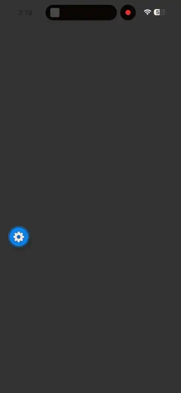
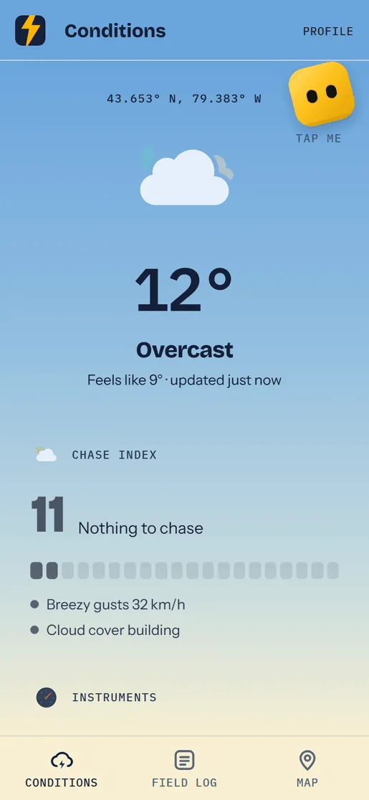
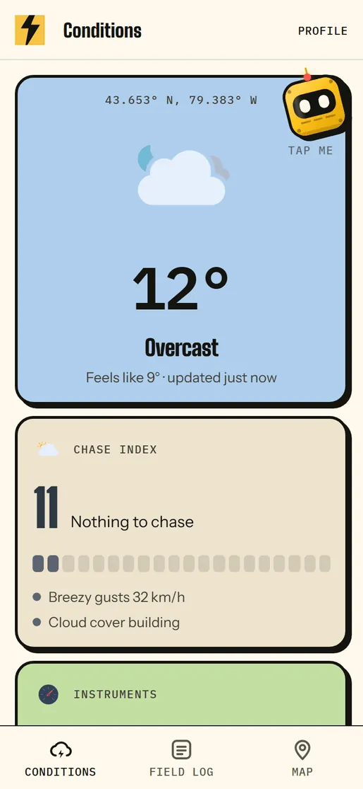
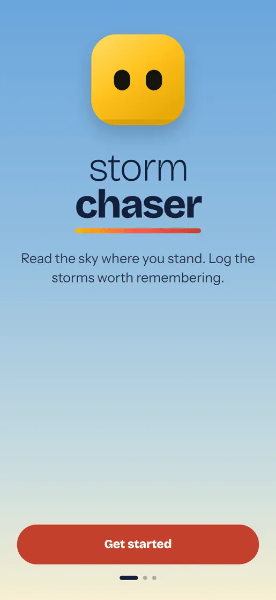
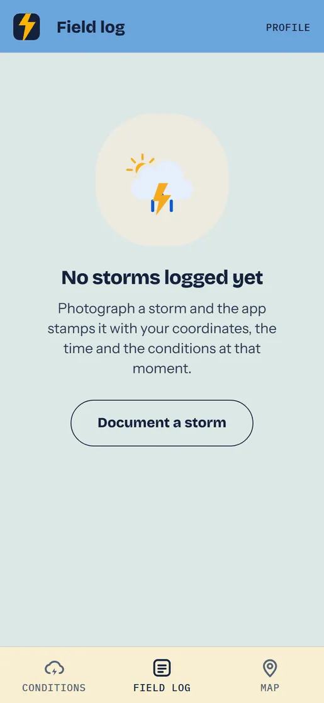
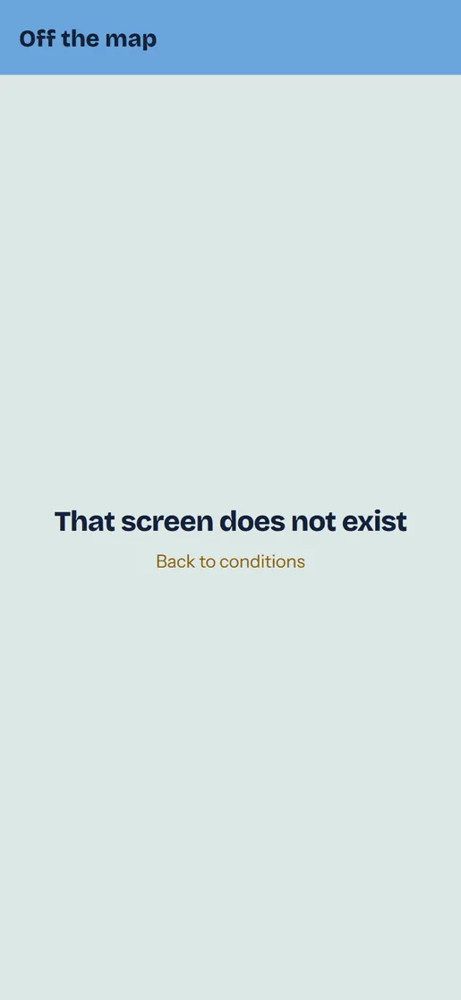
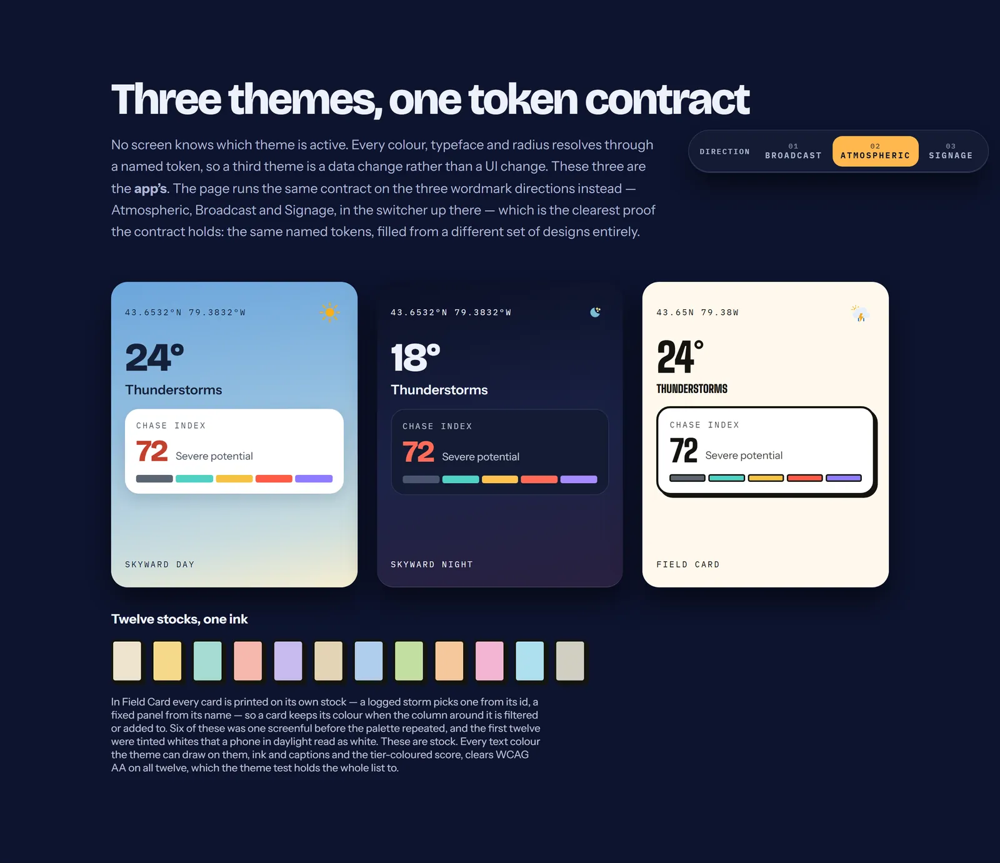
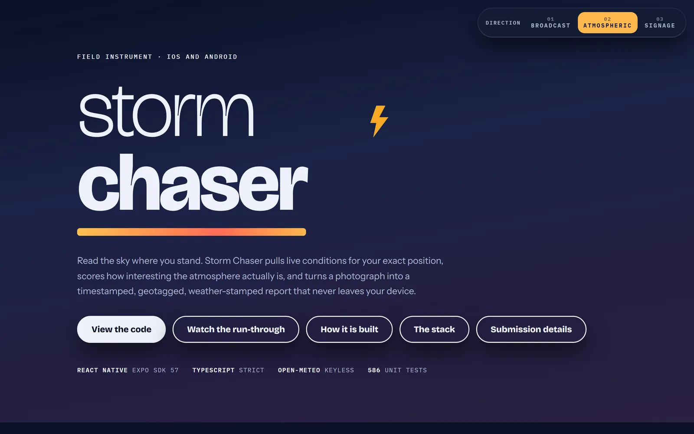
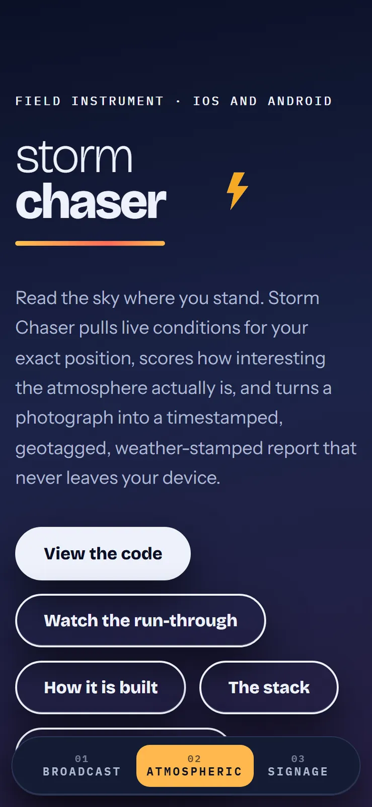
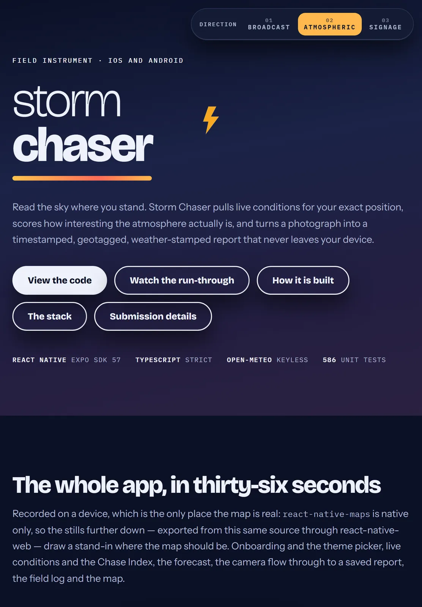

<div align="center">

  

  <h1>Storm Chaser</h1>

  <p>
    A field app for storm chasing hobbyists. It reads the sky where you are standing,
    scores how interesting the atmosphere actually is, and turns a photograph into a
    timestamped, geotagged, weather stamped report that never leaves your device.
  </p>

<p>
  
  
  
  
  
  
</p>

<h4>
  <a href="https://drive.google.com/file/d/1hHfLGWvkn_EwCxRvGiozFD_H-ZrF_eAD/view?usp=sharing">Watch the walkthrough</a>
  <span> · </span>
  <a href="https://stormchaser-field.vercel.app">Showcase site</a>
  <span> · </span>
  <a href="https://stormchaser-field.vercel.app/app">Try it in a browser</a>
  <span> · </span>
  <a href="docs/ARCHITECTURE.md">Architecture</a>
</h4>

  <sub>Built for the Speer Technologies mobile assessment.</sub>

</div>

<br />

## What it is

Generic weather apps answer "do I need a coat". A chaser needs a different question
answered: **can this atmosphere build something, and is it worth driving toward.**

Storm Chaser pulls live conditions for your exact position, surfaces the two variables
generic apps leave out — CAPE and lifted index — and folds them into a **Chase Index**,
a 0–100 score with a ranked list of what drove it. When something happens, the camera
stamps the photograph with the time, coordinates, accuracy and the full weather snapshot,
then writes it to a local field log that works with no signal and no account.

It is a judgement aid, not a forecast product, and it says so in the UI.

<div align="center">
  
</div>

## Quick start

No API keys. Open-Meteo is keyless and cloud sync stays off unless you point it somewhere.

```bash
git clone https://github.com/melaniesigrid/storm-chaser.git
cd storm-chaser
npm install
npx expo start
```

Press `i` for iOS, `a` for Android, or scan the QR code with Expo Go. Node 20+.

```bash
npm test          # 734 tests, no renderer, no device, no mocking framework
npm run typecheck
npm run lint
```

Camera, location and maps need a real device or a development build. For a native build
with the full map provider: `npm run ios` or `npm run android`.

> You can also open the web build at
> **[stormchaser-field.vercel.app/app](https://stormchaser-field.vercel.app/app)** — the
> real app, minus the native camera and map.

## Screenshots

These are the real app, not mockups. `npm run screenshots` re-exports `app/` and `src/`
and drives the result in a browser on every run, so the images cannot drift from the code.
The weather is live: the Chase Index shown is whatever the atmosphere was doing over the
capture position at the time.

| Skyward | Field Card |
| :---: | :---: |
|  |  |

<details>
  <summary><b>More screens</b> — onboarding, the field log, the theme picker, the design system</summary>
  <br />

| Onboarding | Field log | Appearance |
| :---: | :---: | :---: |
|  |  |  |

<div align="center">
  
  
</div>

| Showcase at mobile (390 × 844) | Showcase at tablet (820 × 1180) |
| :---: | :---: |
|  |  |

</details>

> **Two honest gaps.** The **Map** tab and the **capture flow** are missing from this set.
> `react-native-maps` is native only — it calls `codegenNativeComponent`, which has no web
> implementation — and photographing a storm needs a camera and a real sky. Both are in
> the walkthrough video, recorded on a device.

## Features

**Conditions.** Current weather, a 12 hour hourly strip and a 7 day outlook from
Open-Meteo: temperature, apparent temperature, wind, gusts, bearing, pressure, humidity,
cloud, precipitation, plus CAPE and lifted index.

**Chase Index.** A 0–100 heuristic over the weather code, gust strength, rainfall rate and
the convective indices, with a ranked list of what drove the score. One pure, tested
module: [`severity.ts`](src/features/weather/model/severity.ts).

**Field log.** Camera capture or library import, then a metadata form. Choosing a
classification shows a sentence on how to recognise it from the ground — twelve labels are
not self-explanatory, and a wall cloud filed as a shelf cloud is a wrong record rather than
an untidy one. Imported photos are marked as such, because their position and conditions
are the device's at import time, not the storm's. Photo first, record second: if the image
cannot be copied into permanent storage the report is never written, so the log can never
point at a file that is not there.

**Storm seals.** Any report can be stamped as a shareable image — a wax seal with the
coordinates set around the ring, a Field Card printing every instrument, or a collectible
with a tier band and a serial. Saved to the camera roll or handed to the share sheet at
1080×1350. The seal is [one pure function](src/features/storms/seal/sealSvg.tsx) of the
report, drawn in viewBox units, so the preview and the exported file are the same thing at
two sizes.

**Map.** Every report with a fix, coloured by severity tier and fitted to the set, plus
community reports as hollow rings and 22 famous storm places as a third pin shape.

**Storm legends.** 22 places (Catatumbo lightning, Hector the Convector, the Tri-State
Tornado) with licensed photography, the mechanism, and checkable figures including the
great-circle distance from you. A legend of the day surfaces on Conditions.

**Air and pollen.** European AQI, UV index, PM2.5 and PM10, and six pollen species banded
on their own scales — five grains of ragweed is a moderate day and five of birch is
nothing. Outside Europe it says pollen is not modelled there rather than printing a
confident zero.

**The real sky.** Dark themes draw an animated starfield and the **actual phase of the
moon**, computed from the sun and moon ecliptic longitudes rather than a days-since-new
approximation, and checked in tests against published ephemerides.

**Offline.** A persisted 24 hour query cache, explicit offline and stale banners over the
last good reading with its age, and a bundled sample dataset you opt into. The field log
needs no network at all.

**Themes.** Three choices over four themes: **Skyward** follows the sun where you are
standing and resolves to day or night on its own, plus **Broadcast** and **Field Card**.
No screen knows which is active; each asks the active theme for a token.

**Accessibility is asserted, not claimed.** [`theme.test.ts`](__tests__/theme.test.ts)
holds WCAG AA for body text, muted text, both tab states and the primary action across
every theme, with regression guards for two contrast defects that shipped in v1.0.
Nothing renders below 12px; every tappable control clears 44px. Every animation respects
Reduce Motion.

## Brief coverage

| Requirement | Status |
|---|---|
| Current weather from device location | Open-Meteo, keyless, live |
| Meteorological detail for chasers | Temp, apparent temp, wind, gusts, bearing, pressure, humidity, cloud, precipitation, CAPE, lifted index |
| "Not found" view | Dedicated component, with retry and sample data fallback |
| Camera capture | `expo-camera`, photo copied to app document storage |
| Photo import | `expo-image-picker`, EXIF timestamp preferred over the import clock, source recorded |
| Storm classification help | A recognition sentence per type, on selection and on the report |
| Storm lore | 22 legends with licensed photography and checkable figures |
| Photo metadata | Conditions, coordinates, accuracy, date and time, notes, classification |
| Local persistence | AsyncStorage envelope plus file storage, versioned, migration hook |
| Navigation | Expo Router, three tabs plus modal capture, detail, seal and legend routes |
| Forecast integration | 12 hour hourly strip and 7 day outlook |
| Map visualisation | `react-native-maps`, severity coloured pins, auto fitted region |
| Offline functionality | Persisted query cache (24 h), offline and stale banners, bundled sample data |
| Dark mode | Four themes including a dedicated night theme, following the sun until the user chooses |
| Skeleton screens | Layout matched skeletons on both data screens |
| Pull to refresh | Conditions and field log |
| Cloud integration | Upload client plus a community feed; no keys, sample-backed unless configured |
| Unit tests | 734, across formatting, severity, mapping, the repository, the theme contract, the seal, air quality, moon phase and EXIF date resolution |

Three places on the showcase site go further: the
[coverage matrix](https://stormchaser-field.vercel.app/#coverage) maps each requirement to
the files that answer it, [how it is put together](https://stormchaser-field.vercel.app/#architecture)
has the flow diagrams, and [the stack](https://stormchaser-field.vercel.app/#stack) lists
every dependency and what it is doing here.

### Known limits

- **Cloud sync is the client half only**, as the brief specifies. There is no backend and
  nothing is uploaded; `syncState` is modelled but only moves when a sync target exists.
- **Community reports resolve from a bundled sample set**, and the map badges them as demo
  data rather than passing fictional chasers off as real.
- **The network probe polls every 15 seconds** rather than subscribing. A production build
  would use NetInfo and TanStack Query's `onlineManager`.
- **Component rendering is tested thinly.** Most of the suite asserts pure functions;
  broader screen-level rendering tests are where the next hour goes.
- **One JSON envelope for all reports** is right at this scale and wrong past a few
  thousand entries. The migration path is noted in the repository.
- **NativeWind is configured but unused.** Styling is inline styles resolved from theme
  tokens; no `className` appears in the codebase.

## Architecture

Three decisions worth calling out. The long version is in
[`docs/ARCHITECTURE.md`](docs/ARCHITECTURE.md).

**Repository pattern over a storage port.** `StormRepository` depends on a three-method
`KeyValueStore` interface, not on AsyncStorage. The clock and the id generator are injected
too. The result is a data layer with real coverage and no mocking framework, and a one-line
change to move to SQLite or MMKV.

**Result types instead of exceptions at the boundaries.** Every client and repository
method returns `Result<T, AppError>` with a typed error kind. That is what lets the UI tell
"no data for these coordinates" (a Not found view) from "the radio is off" (an offline
banner over cached data) rather than showing one generic error for both.

**Weather denormalised onto the report.** A field log entry has to stay readable years
later, and no forecast API serves historical conditions for an arbitrary past timestamp.
The snapshot is copied onto the record at capture time rather than referenced.

## Project structure

```
app/                  Expo Router routes: tabs, capture, storm, seal, legend, onboarding
src/core/             Theme, UI primitives, charts, icons, sky, storage, utils
src/features/         weather · storms (incl. seal) · location · air
src/services/         Query client, network probe, cloud client
__tests__/            734 tests. Domain, data and theme layers.
docs/                 Architecture, branding, AI disclosure, submission, time log
landing/              The static showcase site, deployed to Vercel
```

## Docs

| Document | What is in it |
|---|---|
| [Architecture](docs/ARCHITECTURE.md) | The dependency rule, data flow, and the decisions behind them |
| [Branding](docs/BRANDING.md) | The design process, themes, colour and type scales, icons, the mascot |
| [Submission](docs/SUBMISSION.md) | The brief, answered point by point |
| [AI disclosure](docs/AI_DISCLOSURE.md) | What was AI-assisted and how it was verified |
| [Time log](docs/TIME_LOG.md) | Where the hours went |
| [Image credits](docs/IMAGE_CREDITS.md) | Every photograph, its author and its licence |

## Environment variables

**No API keys are required.** Both variables are optional and live in
[`.env.example`](.env.example).

| Variable | Description | Default |
| --- | --- | --- |
| `EXPO_PUBLIC_WEATHER_BASE_URL` | Open-Meteo endpoint, so it can point at a proxy or mock | `https://api.open-meteo.com/v1/forecast` |
| `EXPO_PUBLIC_SYNC_BASE_URL` | Cloud sync target. Sync is off and community reports fall back to the sample set while empty | `''` |

Both are `EXPO_PUBLIC_`, so they are **inlined into the bundle at build time**. Never put
a credential in either.

## License

**No license file is present**, so under default copyright all rights are reserved: the
code can be read and evaluated, but not reused, modified or redistributed without
permission. Add a `LICENSE` file if that is not the intent.

Third-party assets carry their own terms. [Meteocons](https://github.com/basmilius/weather-icons)
is MIT, the four typefaces are under the [SIL Open Font License](https://openfontlicense.org/),
and every legend photograph is public domain, CC0, CC BY or CC BY-SA, credited in
[docs/IMAGE_CREDITS.md](docs/IMAGE_CREDITS.md).

## Author

**Melanie Arellano Baratto** — [@melaniesigrid](https://github.com/melaniesigrid)

Built for the Speer Technologies mobile assessment.
