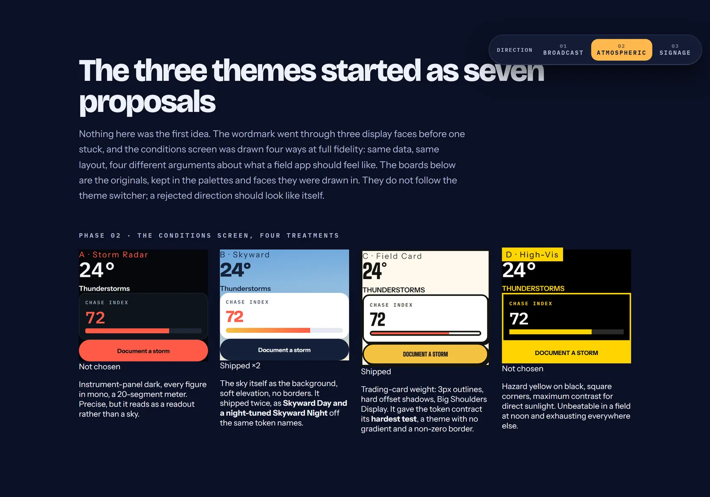

# Branding and design system

Everything visual in Storm Chaser resolves through a named token. This is the long
version: the design process, the themes, the colour and type scales, the icons and the
mascot. The short version lives in the [README](../README.md).

Everything visual resolves through a named token in
[`src/core/theme/themes.ts`](../src/core/theme/themes.ts). A screen never asks which theme is
active; it asks the active theme for a token. Adding a fourth theme is a data change.

## Design process

The theme system below is the *result*. It is worth recording what it beat, because the
token contract exists precisely because these directions disagreed with each other so
hard that no screen could be allowed to hard-code a colour.

Two rounds were drawn at full fidelity on a design canvas before any of it reached
`themes.ts`: three wordmarks, then the conditions screen four ways with identical data
and identical layout, so the only variable was the treatment.

  

 

**Round one: the wordmark.** Three display faces, each with its own app-icon lockup,
palette and motion.

| Direction | Face | Argument | Outcome |
| --- | --- | --- | --- |
| 01 · Broadcast | **Anton** | Ultra-condensed, one weight, no apologies. Reads at 16px on a tab bar and at 124px on a splash. | **Rejected.** One weight means no hierarchy, and there is nothing to build a whole interface out of. |
| 02 · Atmospheric | **Bricolage Grotesque** | Weight as the whole idea: hairline against heavy inside one word, with the optical-size axis holding it together as it shrinks. | **Shipped.** The 200/800 pair became the display token for both Skyward themes and the wordmark on the showcase site. |
| 03 · Signage | **Big Shoulders Display** | Highway signage: hazard stripe, condensed caps, a 100 to 900 variable axis, a "FIELD INSTRUMENT" strapline. | **Partly kept.** Too severe as the everyday voice, but its strapline is the showcase site's hero eyebrow and its amber `#F5C242` and teal `#4FD1C5` are the Active and Unsettled rungs of the chase ladder. |

**Round two: the conditions screen.** The same screen, the same numbers, four treatments.

| Direction | Ground | Display face | Outcome |
| --- | --- | --- | --- |
| A · Storm Radar | `#05070B` instrument dark | IBM Plex Mono throughout | **Rejected.** Precise to the point of reading as a readout rather than a sky. |
| B · Skyward | Sky gradient, soft elevation, 0px borders | Bricolage Grotesque | **Shipped twice**, as Skyward Day and a night-tuned Skyward Night off the same token names. |
| C · Field Card | `#FFF8EC`, 3px outlines, hard offset shadows | Archivo Black | **Shipped.** Also the contract's hardest test: a theme with no gradient and a non-zero border. |
| D · High-Vis | Pure black, hazard yellow, square corners | IBM Plex Mono | **Rejected.** Unbeatable in a field at noon, exhausting everywhere else. |

Three things carried out of the exploration into the code, and they are the reason the
rest of this section reads the way it does:

- **A theme is not a colour scheme.** Skyward and Field Card disagree on radius, border
  width, elevation *and* typeface. So `radius`, `borderWidth` and the display family are
  tokens rather than constants. See [`src/core/theme/themes.ts`](../src/core/theme/themes.ts).
- **The chase ladder carries meaning.** All four boards showed the same five
  tiers, and all four needed different values for them. That split became `tier` and
  `tierText`, resolved per theme.
- **Two levels of mascot finish.** Volt was drawn minimal for Skyward and built up with a
  visor, antenna and rivets for Field Card. That is why his level of detail follows the
  active theme rather than a prop.

Both rounds are reproduced, in their original palettes and faces, in the *Design process*
section of the [showcase site](../landing/index.html).

## Themes

| Theme | Mood | Surface treatment | Display face |
| --- | --- | --- | --- |
| **Skyward Day** | Bright, atmospheric | Soft elevation, 0px borders, 24px panels | Bricolage Grotesque ExtraBold |
| **Skyward Night** | Low light, night chasing | Glow elevation, 1px borders, 24px panels | Bricolage Grotesque ExtraBold |
| **Field Card** | Bold, collectible | Hard elevation, 3px outlines, 20px panels | Archivo Black |

## Color Reference

  
<b>Skyward Day</b>: the default, and what an unconfigured light device gets

   

| Token | Hex | |
| --- | --- | --- |
| `accent` | `#C4402E` |  |
| `text` | `#14213A` |  |
| `textMuted` | `#3A4761` |  |
| `background` | `#F2F0E8` |  |
| `surface` | `#FFFFFF` |  |
| `surfaceSunken` | `#EDEAE0` |  |
| `border` | `#D6D2C6` |  |
| `backgroundGradient` | `#6E9AD4` → `#A9C3E4` → `#F7F4EC` |    |

  
<b>Skyward Night</b>: the only dark theme

   

| Token | Hex | |
| --- | --- | --- |
| `accent` | `#FFB84D` |  |
| `text` | `#EDF1FA` |  |
| `textMuted` | `#98A3C0` |  |
| `background` | `#0B1026` |  |
| `surface` | `#141B33` |  |
| `surfaceSunken` | `#0D1226` |  |
| `border` | `#2B3558` |  |
| `backgroundGradient` | `#0B1026` → `#1B2347` → `#2A2140` |    |

  
<b>Field Card</b>: flat by design, hard outlines, no gradient

   

| Token | Hex | |
| --- | --- | --- |
| `accent` | `#F5C242` |  |
| `text` | `#14140F` |  |
| `textMuted` | `#3F3E34` |  |
| `background` | `#FFF8EC` |  |
| `surface` | `#FFFFFF` |  |
| `border` | `#14140F` |  |

## The chase ladder

Five tiers, one meaning. The same colours drive the index meter, the map pins and the
report cards, so a colour means the same thing everywhere in the app; each theme only
changes its values. Fills and text colours are separate tokens (`tier` and `tierText`)
because a fill that reads well as a 6px bar does not necessarily clear AA as 13px type.

| Tier | Score | Fill (Skyward Day) | Fill (Skyward Night) |
| --- | --- | --- | --- |
| Dormant | 0 to 14 |  `#5B6472` |  `#4A5470` |
| Unsettled | 15 to 34 |  `#4FD1C5` |  `#4FD1C5` |
| Active | 35 to 59 |  `#F5C242` |  `#FFC24D` |
| Severe | 60 to 79 |  `#FF5A47` |  `#FF6B57` |
| Extreme | 80 to 100 |  `#8E7CFF` |  `#A78BFF` |

## Typography

Loaded through `expo-font` and `@expo-google-fonts` in
[`app/_layout.tsx`](app/_layout.tsx). Both display faces load up front, because switching
theme must not wait on a font, and a font failure degrades to system faces rather than
blocking the app.

| Role | Family | Weights | Notes |
| --- | --- | --- | --- |
| Display (Skyward) | **Bricolage Grotesque** | 200, 800 | The typeface is itself a theme token; it is what makes Skyward read as sky |
| Display (Field Card) | **Archivo Black** | 400 | Ships one weight, so the light display role falls back to Instrument Sans 700 rather than pretending a 200 exists |
| Body | **Instrument Sans** | 400, 500, 600, 700 | |
| Mono | **IBM Plex Mono** | 400, 500, 600 | Always mono, in every theme: columns of figures have to line up |

## Icons

[**Meteocons**](https://github.com/basmilius/weather-icons) (flat style), rendered natively
through `react-native-svg` via `react-native-svg-transformer`, so each icon is a real
component rather than a font glyph or a bitmap.

Three decisions worth the note, all documented at the source:

- **Flat style over fill.** Flat carries no gradients, which keeps icons crisp at 28px in the
  forecast strip where a gradient turns to mud.
- **Static files.** The animated `@meteocons/svg` package embeds its motion as
  SMIL, which `react-native-svg` does not implement, so those files would render static at a
  larger payload. Motion on the hero condition comes from Lottie instead.
- **A curated subset of 25 names.** Metro needs every import to be static, so the shipped
  set is a 25 name string union in [`src/core/icons/names.ts`](../src/core/icons/names.ts)
  with no imports, which keeps the WMO-code-to-icon mapping unit testable without a
  bundler. [`weatherIcons.test.ts`](../__tests__/weatherIcons.test.ts) asserts the registry in
  [`WeatherIcon.tsx`](../src/core/icons/WeatherIcon.tsx) covers every declared name.

Day and night variants are mapped separately: a sun behind a cloud at 2am is the kind of
detail that makes an app feel like nobody used it.

Tab bar icons are not Meteocons either. They are three drawn `react-native-svg` marks
(a bolt in a cloud, a stack of ruled cards, a dropped pin) sharing one 1.9px stroke and
one corner radius, tinted with the active tab token. They were Unicode characters
(`◬` `▤` `◎`) until the bar started looking accidental: a text glyph renders in whatever
fallback face the platform picks, which meant three different weights and three different
optical sizes sitting next to each other.

## Logo and mascot

The identity lives in [`src/core/brand/`](../src/core/brand/) and is drawn, not exported.

**The wordmark** is two words in two weights with a ray under them: "storm" at Bricolage
200 over "chaser" at 800, and a three-stop gradient bar that draws itself in left to right
once on appearance. The whole idea is weight contrast inside a single name, which is why
the lockup needs no icon to be recognisable. Field Card cannot do weight contrast,
because Archivo Black ships one weight. There the same idea is carried by case and by a
hard square ray instead of a rounded one. `Wordmark` takes a cap `size` and derives everything
from it, so it is the same component at 56px in onboarding and 26px in Settings.

**The monogram** is `sc` struck through by a bolt on a plate, in
[`Monogram.tsx`](../src/core/brand/Monogram.tsx). The bolt is taller than the plate and
cropped by it, so it reads as a strike passing through the mark rather than a sticker
inside it. The letters are drawn twice, stroke pass then fill pass, because
`react-native-svg` does not implement SVG `paint-order` and a centred stroke would
otherwise eat into the letterforms.

**App icon sources** are in [`assets/brand/`](../assets/brand/) as SVG. They drop the `sc`
and keep the bolt alone: at 48px on a home screen the letters collide with the bolt's own
crossbar. They are not yet wired into `app.json`: Expo needs PNG, and rasterising an SVG needs a
tool this repo does not depend on. [`assets/brand/README.md`](../assets/brand/README.md) has
the two commands and the exact `app.json` block.

**Volt**, the mascot, is one square and two eyes, built from `View` geometry in
[`src/core/ui/Volt.tsx`](../src/core/ui/Volt.tsx) with no image assets, so he renders from a
24px badge to a 150px onboarding hero with no export step. His level of detail follows the
theme rather than a prop: Skyward keeps him to a shell and two eyes, Field Card gives him
the visor with a highlight sweeping across it, the pulsing antenna, the rivets and the
vents that match its heavier outlines. He has five moods: `idle`, `alert`, `logged`,
`offline`, `asleep`. The last of those floats two z's rather than closing his eyes,
which is the only thing that distinguishes it from `offline`.

His shell colour is `theme.brand.voltShell`, not the accent. Pointing it at the accent was
a real bug rather than a shortcut: it made him rust on Skyward Day, amber on Skyward
Night, and the same colour as the primary button on Field Card, a different character on
every theme. He is yellow because he is yellow, powered down to slate at night, and his
moods are what light him up. `theme.test.ts` now asserts the idle shell never collides
with a mood fill, since that would make changing mood show nothing at all.

<!-- Env Variables -->
