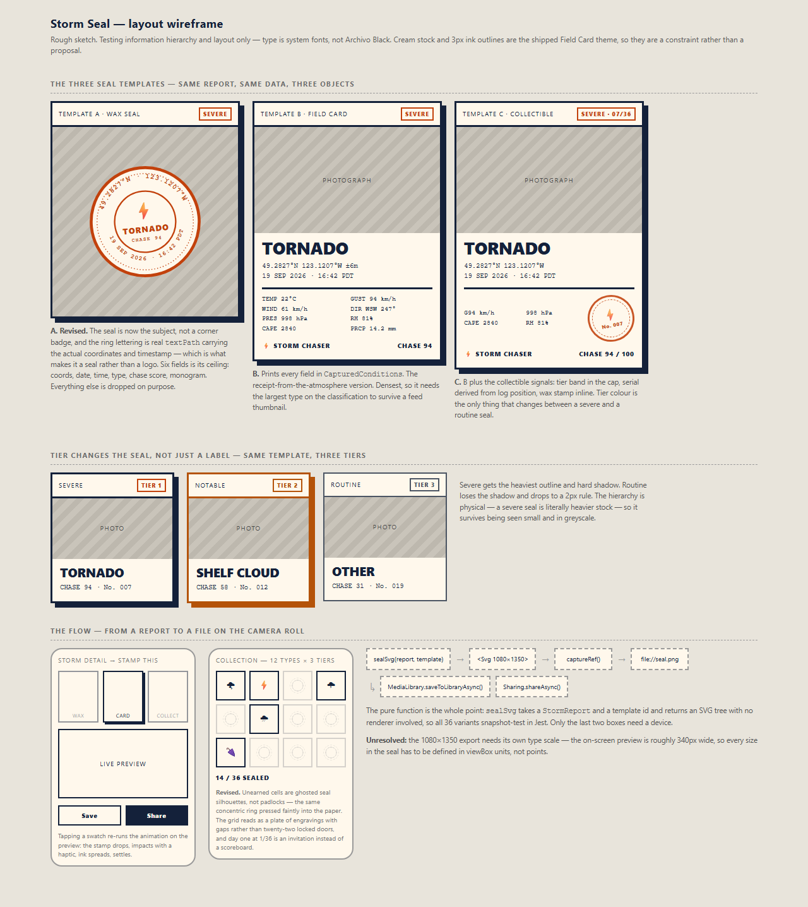

# Design: Storm Seal — a shareable, downloadable stamp for a storm report

Generated by /office-hours on 2026-09-19
Branch: main
Repo: melaniesigrid/storm-chaser
Status: APPROVED
Mode: Builder
Reviewed: three adversarial passes (6/10 → 8/10 → 9/10 PASS), 27 findings,
all addressed or recorded below

## Problem Statement

A `StormReport` is currently a private record. It holds a photograph, a
timestamp, a position, a classification and a frozen block of weather
instruments, and none of it can leave the device in a form anyone else would
want to look at. The ask: turn a report into a single image — a seal — that
prints where you were, when it was, and what the sky was doing, that looks good
enough to post, and that the user can actually download.

## What Makes This Cool

Most photo-stamp apps can print a date and a place. This one can print
`CAPE 2840 J/kg · gusting 94 km/h · 998 hPa`, frozen at the instant of the
shutter. That is not a caption, it is a receipt issued by the atmosphere, and
the data for it is already persisted on every report.

The landscape search sharpened this. Strava ships exactly the obvious version —
one branded stat card — and the standing complaint is that *"the design looks
identical to every other runner's post."* That single complaint supports a paid
cottage industry (StatShot, PicStat, Kudoro, Velogram) whose entire product is
**variation**. People pay money not to look like everyone else.

**The insight:** everyone builds one template because they assume the *brand*
is what makes a share card good. The evidence says uniformity is the failure
mode. Storm Chaser is differently placed — a run is a run, but a tornado is not
a dust storm.

Two axes of variation, and it is worth being precise about which is which,
because an earlier draft of this document conflated them:

- **Chosen by the user: 3 templates.** For any one report the picker offers
  three seals. This is the axis the user controls.
- **Given by the sky: 12 classifications.** `tier` is a fixed property of each
  storm type in `STORM_TYPES`, not an independent axis — `tornado` is always
  severe, `other` is always routine. So there are 12 reachable type/tier
  combinations, not 36. Tier affects the seal's weight and accent; the user
  does not pick it, the storm does.

`sealSvg(report, templateId)` therefore spans **12 types × 3 templates = 36
distinct seals**, which is the number the snapshot tests assert. The variation
thesis holds; the earlier arithmetic behind it did not.

## Constraints

- Expo SDK 57 / RN 0.86, TypeScript strict, 560 passing tests. The repo holds
  itself to a "testable without a bundler" standard (see the comments in
  `src/features/storms/model/stormTypes.ts`); the seal must meet it.
- Local-first. Nothing leaves the device unless the user shares it.
- Must run in Expo Go. No custom dev build, no eject — this is an assessment
  submission and the build has to be startable cold by an assessor.
- `react-native-svg@15.15.4` is already a dependency, and its `Svg` ref exposes
  `toDataURL(callback, options)`. `expo-sharing` and `expo-media-library` are
  not installed and must be added; both are in this SDK's bundled native
  modules, so both work in Expo Go.
- Field Card is a shipped theme: cream `#FFF8EC`, 3px ink outlines, hard offset
  shadows, display face **Big Shoulders Display 900**, light display
  **Big Shoulders Display 300**, mono IBM Plex Mono.
  *(Not Archivo Black. `themes.ts:462` records that Big Shoulders replaced it
  precisely because it carries a real 100–900 range. Five README lines still
  say Archivo Black and are stale — **333, 358, 436, 477, 815**. Line 436 is
  the damaging one: it claims Field Card "ships one weight, so the light
  display role falls back to Instrument Sans 700", which is no longer true and
  directly contradicts this design's use of Big Shoulders 300. Worth fixing
  separately, since the README is what an assessor reads.)*
  The seal adopts this theme wholesale; no new art direction. It should use
  the weight range, which the previous single-weight face could not offer.
- `TODOS.md` carries an open P1 requiring on-device verification of the
  permission-timing fix. This feature adds a second permission prompt
  (media library), so it lands in the same risk area.

## Premises

1. **The data model is done.** `StormReport` already carries every field a seal
   prints. This is a render-and-export feature, not a data feature. No change
   to the persisted shape.
2. **Export is the feature, not a follow-up.** "Users must be able to download"
   means the rasterise → save → share path ships, or nothing ships. A seal you
   cannot save is a screenshot with extra steps.
3. **Templates are a registry, not three screens.** A `SEAL_TEMPLATES` table
   alongside `STORM_TYPES`, so the picker maps over data and the tests are
   table-driven. This is the idiom the repo already uses.
4. **The seal is a printed object, not app chrome.** It renders as Field Card
   stock regardless of the active app theme, so a seal shared from Skyward
   Night is the same artifact as one shared from Field Card.
5. **Video export is out of reach here.** `expo-gifski` exists but requires a
   custom dev build *and* an already-recorded video as input. There is no
   Expo Go path from a Reanimated animation to an exported file. The animation
   plays on screen; the exported artifact is a still.
6. **Nullable fields are the normal case, not the edge case.** `conditions`,
   `coordinates`, `locationAccuracyM` and `capeJkg` are all nullable on
   `StormReport`. A seal that assumes them is broken for any report filed with
   location denied. Degraded rendering is specified per template, not improvised.

## Approaches Considered

### Approach A: Native views + captureRef — not chosen
Build templates from the existing `Panel`/`Text` primitives, mount offscreen at
export size, screenshot to a file. Fastest to first pixel and flexbox handles
wrapping, but the output is only testable by rendering. Rejected on
testability alone.

*(An earlier draft also rejected A for cross-platform rasterisation drift. That
reason was wrong and has been removed: SVG `<Text>` is rasterised by each
platform's own text engine too, so B inherits the same drift. Testability is a
sufficient and honest reason on its own.)*

### Approach B: SVG seal engine — CHOSEN
`react-native-svg` draws the whole seal as one SVG at a fixed `1080×1350`
viewBox. A pure function produces a layout model; a dumb mapper turns that into
SVG elements; `Svg.toDataURL` rasterises at full export size.

### Approach C: B plus a procedural fingerprint — deferred, not rejected
Hash coordinates + timestamp into a seed driving banknote-style guilloche
engraving in the ring, so every seal is one-of-one. `src/core/utils/random.ts`
already provides seeded generation (mulberry32). Deferred on taste risk, not
technical risk: procedural ornament reads as noise unless carefully tuned.
A pure addition to B's ring renderer; revisit once the engine exists.

## Recommended Approach

**Approach B, the SVG seal engine.**

A pure layout function makes all 36 type × template combinations assertable in
Jest with no renderer, which is the standard `stormTypes.ts` already sets for
itself.

### Shape

```
src/features/storms/seal/
  sealTemplates.ts   SEAL_TEMPLATES registry: { id, label, description,
                     fields } — same table idiom as STORM_TYPES, though not
                     the same columns (no tier: tier comes from the report).
  sealData.ts        sealData(report, { serial }) -> SealData. Pure, total.
                     Derives tier from STORM_TYPES, formats coordinates and
                     timestamp, and models every absent field explicitly as
                     null — never as an empty string.
  sealLayout.ts      (SealData, templateId) -> SealLayout. Pure, no JSX.
                     A serialisable model: positioned text runs, rules,
                     the ring spec, the photo frame. ALL dimensions in
                     viewBox units. This is the snapshot-tested surface.
  sealSvg.tsx        SealLayout -> <Svg viewBox="0 0 1080 1350">. A dumb
                     mapper with no logic worth testing.
  sealSerial.ts      FNV-1a over report.id -> six uppercase hex digits. Pure.
  sealExport.ts      Svg.toDataURL (offscreen, no size options)
                                   -> base64 decode -> File.write
                                   -> MediaLibrary.saveToLibraryAsync
                                   -> Sharing.shareAsync
  SealPreview.tsx    Mounts sealSvg at preview scale, runs the animation
  SealExportSvg.tsx  Mounts sealSvg offscreen at full size, holds the ref
  SealPicker.tsx     Maps over SEAL_TEMPLATES, three swatches
app/seal/[id].tsx          The stamp screen
app/(tabs)/collection.tsx  The 12-cell plate
```

**Base64 to disk.** `MediaLibrary.saveToLibraryAsync` needs a file URI, so
`toDataURL`'s base64 must hit disk first, and the two file APIs differ here.
`src/features/storms/data/photoStore.ts` already uses the modern
`File`/`Paths`/`Directory` API, which has no base64 write mode; base64 writing
lives in `expo-file-system/legacy`. **Decode the base64 to a `Uint8Array` and
use `File.write()`**, staying on the modern API the repo already standardised
on rather than importing a deprecated path into an assessment build.

Splitting `sealLayout` from `sealSvg` is the change that makes premise 3 real:
the layout model is genuinely rendererless and table-driven, and having one
dimension table in viewBox units becomes a type constraint rather than a
matter of discipline.

### The export path

Rasterise with `Svg.toDataURL`, from an export `Svg` mounted offscreen at its
full layout size, **called with no size options.**

The second half of that sentence is load-bearing and was wrong in an earlier
draft. `toDataURL(cb, { width, height })` is not portable:

- **Android** (`SvgView.java:365`) allocates a `width × height` bitmap and
  draws into it, computing the viewBox transform from `canvas.getWidth()`.
  Renders at the requested size, as expected.
- **iOS** (`RNSVGSvgViewModule.mm:54`, `RNSVGSvgView.mm:376`) creates a
  `UIGraphicsImageRenderer` at the requested size but then calls `drawRect:`,
  which at `RNSVGSvgView.mm:331` **ignores its own rect** and passes
  `[self bounds]` — the mounted view's on-screen frame. A seal mounted at 340pt
  is drawn at 340pt in the corner of a 1080pt canvas, and
  `UIGraphicsImageRenderer` applies screen scale on top, so the file is
  3240×4050 px on a @3x device.

Called with no options, iOS uses `svg.boundingBox` and Android uses
`getWidth()/getHeight()`, and both agree with the mount. So the export `Svg` is
mounted offscreen (`position: 'absolute', left: -20000`) at full size, separate
from the preview.

What this means honestly: `toDataURL` does **not** remove the offscreen mount.
It is still the right choice, for two reasons that survive — it drops
`react-native-view-shot` from the dependency list, and it rasterises at vector
level so type stays sharp rather than being resampled from a 340px capture.
But Approach A's offscreen-mount awkwardness is inherited here, and the doc
should not pretend otherwise.

**Mount at `1080 / PixelRatio.get()` dp.** An offscreen mount of 1080 *points*
yields `1080 × PixelRatio.get()` pixels on iOS and 1080 device-pixels on
Android, so dividing first lands on exactly 1080×1350 px on both.

This is not only about tidiness. `toDataURL` returns the entire PNG as a
JavaScript string, which then has to be decoded and copied into a
`Uint8Array` on the JS thread. At @3x the image is 3240×4050 — roughly 6–8 MB
of PNG, 9–11 MB as base64 — on top of a ~52 MB offscreen backing layer for a
1080pt mount. That is a multi-second freeze and a plausible out-of-memory on a
low-end Android device. Dividing by `PixelRatio.get()` cuts both to about a
ninth.

Decoder: `Uint8Array.from(atob(b64), (c) => c.charCodeAt(0))`. There is no
`Buffer` in React Native and the repo has no helper, so this belongs in
`sealExport.ts`.

The success criterion is still written as "at least 1080 px wide, 4:5" rather
than exactly — if the spike shows the division landing a pixel off on some
device, that is not a defect worth failing a build over.

Fallback if the offscreen `toDataURL` still disappoints on a device:
`captureRef` on a plain wrapping `<View collapsable={false}>` — not on the
`Svg` ref, which has a history of returning blank bitmaps on Android.

### The three templates

`fields` on each template row is an explicit ordered list of `SealField` ids,
not a count. `CapturedConditions` has eleven members; each template names
exactly which it prints.

| | Prints | Degraded rendering |
|---|---|---|
| **Wax seal** | Large centred circular stamp over the full-bleed photo. Ring lettering: coordinates on the upper arc, timestamp on the lower. Centre: monogram, classification, chase score. | No coordinates → the timestamp is promoted to the upper arc and the classification drops to the lower, so the ring keeps its optical balance rather than going bald at the top. No conditions → chase score line is omitted, not zeroed. |
| **Field Card** | Photo on cream stock, classification in Big Shoulders 900, coordinates with accuracy, timestamp, then eight of the eleven instruments: `temperatureC`, `windSpeedKmh`, `windGustKmh`, `windDirectionDeg`, `pressureHpa`, `humidityPct`, `capeJkg`, `precipitationMm`. `conditionLabel` sits above the grid as prose; `conditionCode` and `chaseScore` are used but not printed as rows. | No coordinates → the line reads `NO FIX RECORDED` in the mono face at instrument size — not in a lighter display weight, because tier owns weight. No conditions → the grid is replaced by a single rule and `— NO CONDITIONS RECORDED —`. Null `capeJkg` → that one cell reads `CAPE —`. |
| **Collectible** | Field Card's frame, tier band in the cap, serial, inline wax stamp, chase score as `94 / 100`. Four instruments only: `windGustKmh`, `pressureHpa`, `capeJkg`, `humidityPct` — the four a chaser would quote. | As Field Card. No conditions → the instrument block and the chase score both drop, and the stamp carries the classification alone. |

### Provenance: library photos are marked

`types.ts` already carries the decision: *"an imported shot carries the
conditions and position of the import, not of the storm, and a field log that
cannot tell the two apart is not evidence of anything."* A seal is that record
made public, so it inherits the obligation.

A report with `photoSource: 'library'` is marked:

- **Field Card and Collectible:** `FILED FROM LIBRARY` in the cap, and the
  instrument grid's enclosing rules switch from solid to dashed.
- **Wax Seal:** a straight `FILED FROM LIBRARY` caption in the centre block
  beneath the classification. Not the lower arc — that carries the timestamp
  in the ordinary case and the two would collide.

The data is still shown, because it is real data about the moment of filing;
the seal simply never claims it was measured under that sky.

**Two channels provenance must not use**, both because they already carry
other meaning:

- **Weight.** Tier owns weight (see below). A severe tornado filed from the
  library cannot be both the heaviest and the lightest thing on the card.
- **Type family.** Field Card's instruments are IBM Plex Mono. Switching them
  to Big Shoulders 300 would be a family change dressed up as a weight change,
  which reads as a bug. Dashed rules carry the same signal without touching
  the type.

This is the most interesting product question the feature raises, and the
codebase had already answered it.

### Tier is physical, not chromatic

Severe gets the heaviest outline and a hard offset shadow; notable keeps the
shadow at the amber accent; routine drops the shadow entirely and falls to a
2px rule. Weight and shadow, not just hue — so the hierarchy survives being
seen small, in greyscale, and by anyone with a colour vision deficiency.

### The serial

Log position is not a stable identity: delete one report and every seal already
shared with a higher serial is wrong about itself. For an artifact framed as
collectible that is a correctness bug.

The serial is **FNV-1a over `report.id`, rendered as six uppercase hex
digits** — `No. 4F2A9C`. Stable forever, requires no access to the log, keeps
`sealData` pure, and FNV-1a is six lines with no dependency, matching the habit
`src/core/utils/id.ts` already sets. (`src/core/utils/random.ts` is a mulberry32
PRNG, not a hash, so it is the wrong tool here.)

Six hex digits, not four: four is 16 bits, where a duplicate becomes more
likely than not somewhere around 300 reports. Duplicate serials on an artifact
whose stated purpose is collectibility would undercut the whole idea.

`sealData(report, { serial })` still takes it as a parameter so the derivation
stays outside the pure transform and remains swappable.

### The collection

**Twelve cells, one per storm classification** — not 36, and not 12 × 3. Tier
is a property of the cell's type, so it colours and weights each cell rather
than multiplying them. A user can reach 12/12; the earlier 36-cell design
capped everyone at 12/36 forever and would have read as 24 permanent failures.

Derived entirely from reports already in the log; no new persisted state.
Unearned cells render as ghosted seal silhouettes, the same concentric ring
pressed faintly into the paper, not padlocks: a plate of engravings with gaps
rather than locked doors.

**Reviewer dissent, recorded:** the adversarial pass recommended cutting the
collection from this build as a second feature that ships nothing toward
download or share. That is a fair reading of the problem statement. It is kept
because it was an explicit decision during the session, on the grounds that
"which stamps am I missing" is the only thing here that would make someone open
the app on a clear day. It stays last in the build order, so it remains the
cheapest thing to cut if time runs short.

### The animation

The stamp drops onto the preview, impacts with `expo-haptics`, ink spreads, it
settles. Reanimated 4.5 is already installed. Note that the ink spread is a
worklet-driven mask animation, not a spring on a transform — it is cheap, but
not free. It plays on screen only; per premise 5, the exported file is the
settled still.

### Photo fitting

`preserveAspectRatio="xMidYMid slice"` — crop to fill. Letterboxing a portrait
photo onto cream stock produces cream bars inside a cream card, which reads as
a rendering failure rather than as honesty.

### Wireframe



Source: [`storm-seal-wireframe.html`](storm-seal-wireframe.html). Rough on
purpose — system fonts, not Big Shoulders. It resolves layout and hierarchy for
all three templates, the tier ladder, the picker and the grid. Two things in it
are now superseded by this document: the grid is 12 cells rather than 36, and
the display face has a weight range.

## Open Questions

1. **The ring has a character budget.** `49.2827°N · 123.1207°W` only just fits
   the upper arc at the sketched radius. The sharper risk is not decimal places
   but that the same string lays out at a different arc length on iOS and
   Android, which no choice of precision fixes.

   Convention: hemisphere letters, no minus sign (`123.1207°W`, never
   `-123.1207°`). Worst case is 10 glyphs per hemisphere at four decimal
   places, the same length either way, so the convention is a legibility
   choice rather than a budget one.

   **The seal needs its own ring formatter, not `formatCoordinates`.** The
   existing util (`src/core/utils/format.ts:49`) emits
   `49.2827° N, 123.1207° W` — a space before each hemisphere letter and a
   comma-space separator. That is 11 glyphs per hemisphere plus four of
   separator, against an arc this document already describes as only just
   fitting. The ring's string is `49.2827°N · 123.1207°W`, and the arc budget
   is measured against that.

   Resolution: assert the worst-case string against a measured arc budget in a
   test, and render it on both platforms during the step 1 spike, before the
   Wax Seal template is designed around it.
2. **Collection day one.** At 1/12 the grid is mostly ghosts. Does it hide
   behind a threshold of three seals, or ship visible from the first report as
   an invitation? Leaning visible; the ghost treatment exists to make that
   bearable.
3. **Does the seal belong on the showcase page?** Rendering `sealSvg.tsx` in
   `landing/` is *not* free — that page is hand-written static HTML with no
   React, no bundler and no build step. The cheap version is a Node script that
   renders seals to static `.svg` files at build time, reusing `sealLayout.ts`
   only. Out of scope for this build; recorded so the expensive version is not
   mistaken for the cheap one.

## Success Criteria

- From a storm report, the seal screen produces a PNG in the camera roll that
  is **at least 1080 px wide and 4:5**, and separately can open the native
  share sheet. (Not "exactly 1080×1350": iOS applies screen scale to an
  offscreen point-sized mount, so a @3x device legitimately yields a larger
  file. See "The export path".)
- All 36 type × template combinations have a passing `sealLayout` snapshot,
  with no renderer and no device.
- `sealLayout` output is independent of the active app theme — asserted by
  snapshotting one report under all four themes and comparing equality. *(This
  replaces an earlier "byte-identical PNG" criterion, which was neither
  achievable nor testable.)*
- Every template renders correctly for a report with `conditions: null` and
  `coordinates: null`, asserted in tests.
- A `photoSource: 'library'` report is visibly marked on all three templates,
  including the combined case of library origin **and** null coordinates on
  the Wax Seal, where the timestamp moves up to the upper arc, the lower arc
  carries the classification, and the centre block gains the
  `FILED FROM LIBRARY` line.
- The collection plate shows 12 cells; every storm type the user has filed is
  earned, every type they have not is a ghost silhouette, and the count line
  agrees with the number of distinct types in the log. Asserted against a
  fixture log in Jest — the plate's state is derived, so it is testable without
  a device.
- The seal is legible as a 150px thumbnail: classification and tier readable,
  coordinates present where they exist.
- Denying the media library permission still leaves Share working, with a
  legible explanation and no dead end.
- `npm run typecheck` and `npm run lint` both clean; the existing 560 tests
  still pass.

## Distribution Plan

Existing pipeline covers this. The *seal itself* is the distributed artifact
and its channel is the OS: the camera roll and the native share sheet. No
account, no upload, no server, consistent with the app's local-first posture.

Configuration, corrected from an earlier draft:

- `app.json` already carries `NSPhotoLibraryAddUsageDescription` and
  `NSPhotoLibraryUsageDescription`. Nothing to add on iOS.
- Android's current `permissions` array has `READ_MEDIA_IMAGES` and
  `READ_EXTERNAL_STORAGE`, which are read grants. Saving needs the
  `expo-media-library` **config plugin** with `savePhotosPermission`, which
  writes the correct manifest entries. Do not hand-add `WRITE_EXTERNAL_STORAGE`
  — it is a no-op on API 29+.
- **None of `app.json` applies in Expo Go**, which uses its own manifest. The
  permission strings cannot be verified until a dev or production build exists.
  Plan for that; do not treat an Expo Go run as evidence they work.

## Dependencies

- `npx expo install expo-media-library expo-sharing`
  *(not `react-native-view-shot` — `Svg.toDataURL` replaces it.)*
- The `expo-media-library` config plugin entry in `app.json`.
- Blocks on nothing. Touches `app/storm/[id].tsx`, the tab layout (a new
  Collection tab), and `app.json`. No changes to `StormRepository` or the
  persisted `StormReport` shape.
- Related risk: the open P1 in `TODOS.md` on permission timing. Verify that fix
  on hardware before adding a second permission prompt, or you will not know
  which prompt caused a failure.

## Next Steps

1. **Spike the risky three before designing anything.** One throwaway screen,
   half a day, answering questions that can each invalidate the architecture:
   - Does an **offscreen-mounted** `Svg` at full size, rasterised with
     `toDataURL(cb)` and no size options, produce a correctly composed image
     of the right dimensions on both platforms? Save it and inspect. The test
     subject must be an **SVG**, not a plain View — a red-square View proves
     nothing about the actual risk. *(The `{width, height}` variant is already
     known to be wrong on iOS; see "The export path". Do not re-test it,
     confirm the offscreen approach instead.)*
   - Does `<Image href={{uri: 'file://…document directory…'}}/>` inside an
     `<Svg>` actually draw the photograph on both platforms? Historically
     flaky with document-directory URIs.
   - Does `<TextPath>` lay out the worst-case coordinate string at the same arc
     length on both platforms?

   If any of the three fails, the fallback is `captureRef` on a wrapping
   `<View collapsable={false}>`, and the ring may need to become a straight
   caption. Better to know now.
2. **Build `sealData.ts`** — the pure, total transform, with explicit nulls.
   Table-driven tests over all 12 types, plus the null-conditions and
   null-coordinates cases.
3. **Build `sealLayout.ts` for the Field Card template only**, fully finished
   and snapshot-tested. Resolve open question 1 here.
4. **Add `sealSvg.tsx`** and see a real seal on screen. Then add the wax seal
   and collectible templates against the proven engine. Snapshot all 36
   type × template combinations.
5. **Wire `app/seal/[id].tsx`**: picker, live preview, Save and Share. Handle
   the permission-denied path — fall back to Share, which needs no permission.
6. **Add the stamp animation.** Last of the shipping work, because it is the
   only part that is pure delight and the only part that can be cut.
7. **Add the collection grid.** Twelve cells, derived state only. First thing
   to cut if time runs short.
8. **Then, optionally, Approach C** — the procedural fingerprint, once the ring
   renderer exists and you can see whether the ornament reads as engraving or
   as noise.

## Reviewer Concerns

Two findings from the adversarial pass were not adopted, and are recorded
rather than silently dropped:

- **Cut the collection grid** (scope). Kept as an explicit session decision;
  see the dissent note in "The collection" above. It is last in the build order.
- **Ship two templates rather than three** (taste). The reviewer's point is
  that the genuine axis is ring-over-photo versus card-with-data, and that
  Collectible is Field Card plus a serial. Three was an explicit session
  decision, and the reviewer marked this as taste rather than a defect.

## The Assignment

Take a storm photo you already have, stamp it by hand in any image editor with
the coordinates, time and conditions you would print, and post it somewhere a
real person will see it.

Not a mockup — an actual post. If nobody reacts, the seal is not finished, and
you will learn that in an evening instead of after a week of SVG work. If
someone asks "what app made that," you have your answer about whether this
belongs in the assessment.
